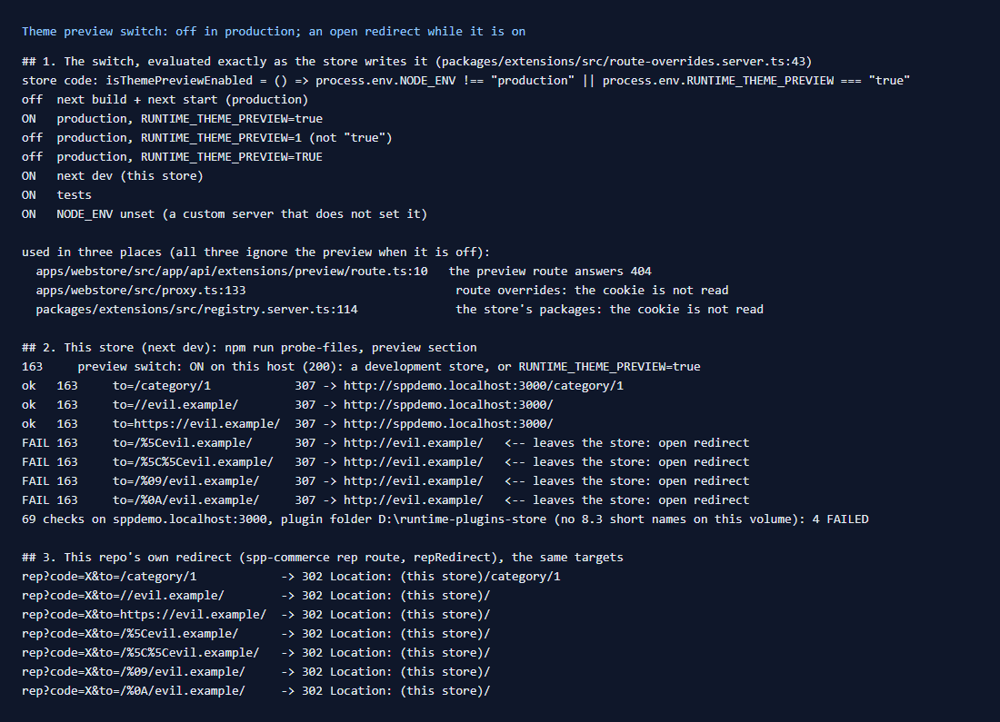

# 163: Is the preview switch off in production by default?

**Listed:** Yes. **Result here:** Yes, confirmed from the store's code. The switch is
`NODE_ENV !== "production" || RUNTIME_THEME_PREVIEW === "true"`. A production build (`next build` + `next start`) has
it off, unless the variable is set to exactly `true`. When it is off, all three places that read the preview cookie
ignore it.

**Found while it is on:** the preview route is an **open redirect**. `/api/extensions/preview?to=/%5Cevil.example/`
redirects to `http://evil.example/`, and so do a tab or a newline after the first `/`. It is the store's code, so it is
reported here with the fix, and `npm run probe-files` now checks for it. This repo's own redirect (spp-commerce's rep
link) refuses all of these targets.

## The switch

| Environment | Preview |
|---|---|
| `next build` + `next start` | off |
| production with `RUNTIME_THEME_PREVIEW=true` | **on** |
| production with `RUNTIME_THEME_PREVIEW=1` or `TRUE` | off (only the exact `true`) |
| `next dev` (this store) | on |
| `NODE_ENV` unset (a custom server that does not set it) | on |

The expression was evaluated as written in `route-overrides.server.ts:43`, for each environment. When the switch is
off:

- `/api/extensions/preview` answers 404 (`preview/route.ts:10`), so the cookie can't be set;
- the proxy does not read the cookie for route overrides (`proxy.ts:133`);
- the store's package list does not read it (`registry.server.ts:114`), so a cookie left over from a test domain does
  nothing.

A production store was not run here: production builds are outside this repo (row 169). On this `next dev` store,
the probe confirms the switch is on (`?list` answers 200).

## The open redirect (store code)

`preview/route.ts` accepts `to` when `to.startsWith("/") && !to.startsWith("//")`, then builds
`new URL(to, origin)`. The URL standard reads `\` as `/` and drops tabs and newlines, so `/\evil.example/` and
`/<tab>/evil.example/` become `//evil.example/`, a link to another host:

| `to=` | Redirects to |
|---|---|
| `/category/1` | the store, `/category/1` |
| `//evil.example/`, `https://evil.example/` | the store, `/` (refused) |
| `/%5Cevil.example/`, `/%5C%5Cevil.example/` | **`http://evil.example/`** |
| `/%09/evil.example/`, `/%0A/evil.example/` | **`http://evil.example/`** |

A link such as `https://<store>/api/extensions/preview?to=/%5Cphishing.example/` shows the store's own domain and lands
on another site. That's only while previews are on, but staging and demo stores usually have them on.

**Fix for the store team:** compare the parsed result, not the string:
`let target = new URL(to, origin); if (target.origin !== origin) target = new URL("/", origin);`.
The same check belongs anywhere a `to`/`returnUrl` is followed.

**This repo's redirect** (`repRedirect` in `src/commerce/server.ts`, the sales rep's link) accepts only
`^\/(?!\/)[^\s\\]*$`: no second `/`, no `\`, no whitespace. All seven targets stay on the store
([output.txt](output.txt)).

## The change: the probe checks the preview switch

`scripts/probe-files.mjs` (row [160](../160-server-bundles-blocked/README.md)) has a new section (163). It reports
whether the switch is on for a host. Where it is on, it follows seven `to` targets and fails on any that lead off the
store. On this store it fails the four above. Once the store is fixed, they pass with no change to the probe.

## How it renders

**In the webstore (base):** for each request, the proxy and `getStoreEntries` read `runtimeThemePreview` only when
`isThemePreviewEnabled()`. With a theme named there, `resolveStoreEntries` uses that theme's chain instead of the
store's ([§2 B.2](../../RENDER-FLOW.md#2-which-store-which-packages-every-request)).

**How this customization joins it:** this theme is previewed on MaxwellsHardware with that cookie. Its
`PreviewBanner` (a `layout.header` slot) offers "Exit preview", which links to `/api/extensions/preview?to=<this page>`.
The page path from the browser always starts with a single `/`.

End-to-end flow, with file and line references in the webstore: [docs/RENDER-FLOW.md](../../RENDER-FLOW.md).

## Where

- `scripts/probe-files.mjs`: the preview section

## How a client does this

Leave `RUNTIME_THEME_PREVIEW` unset in production. Where previews are on (staging, demos), keep the store behind a sign-in
until the redirect is fixed. Run `npm run probe-files -- --host <store host>` on each environment.
