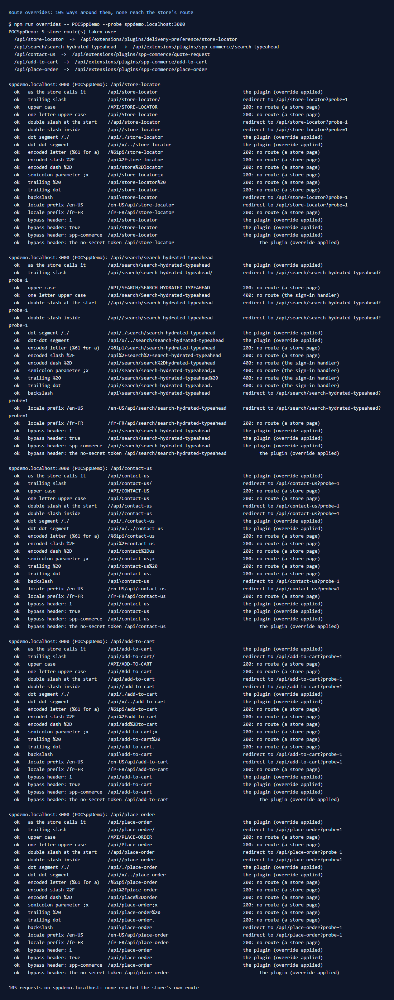

# 164: Can a browser skip a route override?

**Listed:** No (the safe answer), marked Blocked. **Result here:** No, confirmed on the five store routes POCSppDemo
overrides. 105 requests tried to reach the store's own route by writing the path another way, or by guessing the bypass
header. None got there. Each one either reached the plugin, was redirected to the normal path (which the plugin then
takes), or matched no route at all.

## Why it matters here

spp-commerce enforces business rules by taking over store routes:

- `/api/add-to-cart` refuses items the ERP has put on hold (rows [106](../106-change-add-to-cart/README.md), [091](../091-plugin-webhooks/README.md));
- `/api/place-order` refuses an order under the minimum order value (row [107](../107-place-order-logic/README.md));
- `/api/contact-us` keeps quote requests and gives them to the shopper's rep;
- `/api/search/search-hydrated-typeahead` adds synonyms and a "source it" link.

If a shopper could reach the store's own `/api/place-order` another way, the minimum would not hold.

## What was tried (`npm run overrides -- POCSppDemo --probe sppdemo.localhost:3000`)

For each of the five routes (`/api/store-locator` from the delivery-preference plugin, and spp-commerce's four):

| Variant | Result |
|---|---|
| as the store calls it; `/./`, `/x/../` dot segments | the plugin (the path is normalized first) |
| trailing slash, `//` at the start or inside, `\`, `/en-US/` (default locale) | redirect to the normal path |
| upper case, one capital letter, `%61` for `a`, `%2F` for `/`, `%2D` for `-`, `;x`, trailing `%20` or `.`, `/fr-FR/` | no route: a store "not found" page, or the sign-in handler's 400 |
| header `x-runtime-original-route` with `1`, `true`, the plugin name, or the token a store with no secret would use | the plugin |

GET only, so nothing changed. The store's POST routes would answer 405 to a GET. Only POST requests were not tried.

## How the store keeps it closed

- The proxy looks up `request.nextUrl.pathname` exactly in the plugins' `overrides` (`findRouteOverride`,
  `route-overrides.server.ts`). Every spelling that still reaches the route (dot segments, extra slashes, the default
  locale) is first normalized or redirected to that same path. Every other spelling matches no route.
- A plugin's `context.original()` reaches the store's own route with a header token, the SHA-256 of
  `runtime-original-route:` plus the store's secret. Guesses don't match.

**Config note:** the token uses the first of `RUNTIME_ROUTE_SECRET`, `NEXTAUTH_SECRET`, `SECRET` or `API_KEY` that is
set. With none set, it is the hash of the prefix alone, the same on every such store, and anyone could skip every
override. The probe tries that token too. On this store, `NEXTAUTH_SECRET` is set, but it is only 6 upper-case letters.
Production should set a long random `RUNTIME_ROUTE_SECRET`.

## The change: `npm run overrides -- --probe <host>`

`scripts/overrides.mjs`:

- **`--probe <host>`** (new) runs the variants above on every route the store overrides. It sends raw requests (Node
  does not normalize the path) and classifies each answer by the proxy's rewrite header (`x-middleware-rewrite`, sent by
  a development store). It exits with 1 if any request reached the store's own route.
- **Placement now reads installation records** (`placementsFor`, moved from `registry.mjs` into
  `scripts/lib/store.mjs` and shared). Before, a plugin placed only by records (row 154) was reported as "not placed".

## How it renders

**In the webstore (base):** `apps/webstore/src/proxy.ts` runs on every request. `setPortalDataInGlobalStore` →
`findRouteOverride(storeCode, request.nextUrl.pathname, headers)` → a rewrite to
`/api/extensions/plugins/<plugin>/<route>`.

**How this customization joins it:** spp-commerce's manifest has `"overrides"` for four store routes, served by its
routes (`src/commerce/server.ts`). `context.original({ body })` reaches the store's own route when the plugin wants
it ([§7 B.4](../../RENDER-FLOW.md#7-cart-checkout-place-order)).

End-to-end flow, with file and line references in the webstore: [docs/RENDER-FLOW.md](../../RENDER-FLOW.md).

## Where

- `scripts/overrides.mjs`: `--probe`, placement from installation records
- `scripts/lib/store.mjs`: `placementsFor` (shared); `scripts/registry.mjs` imports it

## How a client does this

Run `npm run overrides -- <store> --probe <host>` after each store upgrade, on a development store (the probe reads
its rewrite header). Set `RUNTIME_ROUTE_SECRET` to a long random value on every environment.
