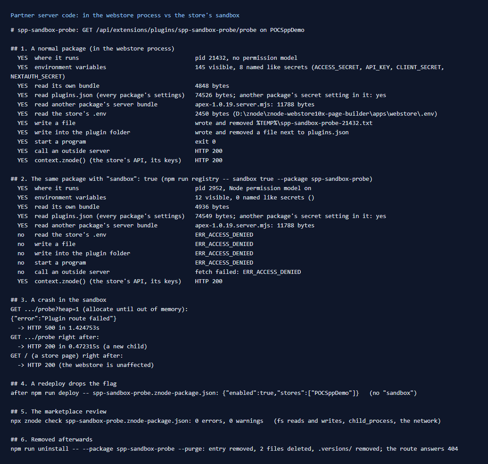

# 165: Is partner code sandboxed?

**Listed:** No, marked Blocked. **Result here:** Partly, and only when chosen. By default a package's server code runs
inside the webstore process and can reach everything there. With `"sandbox": true`, its routes run in a child process
under Node's permission model. That process has no secrets in its environment, cannot read the store's files, write,
start programs or use the network, and a crash ends only that process. **But it can still read the whole plugin folder**,
including `plugins.json` (every package's settings and secrets, every store's records) and other packages' server
bundles.



## What was checked

A test package, `spp-sandbox-probe` (new, in this repo), has one route that tries what a hostile partner package would
do. It answers only yes or no, never what it read. It was installed on POCSppDemo, run in the webstore process, run
again with `"sandbox": true`, then uninstalled.

| What the server code tries | Normal package | `"sandbox": true` |
|---|---|---|
| see the environment | 145 variables, 8 named like secrets (`NEXTAUTH_SECRET`, `API_KEY`, …) | 12, none secret |
| read its own bundle | yes | yes |
| **read `plugins.json`** (every package's settings, spp-commerce's secrets) | yes | **yes** |
| **read another package's server bundle** | yes | **yes** |
| read the store's `.env` | yes | refused (`ERR_ACCESS_DENIED`) |
| write a file (temp folder, plugin folder) | yes | refused |
| start a program | yes | refused |
| call an outside server | yes | refused (`ERR_ACCESS_DENIED`) |
| `context.znode()` (the store's API, its keys) | yes | yes (run by the webstore for it) |
| run out of memory | (would take the store down) | 500 for that call; the next call gets a new process (200); store pages unaffected |

## Gaps found

1. **The sandbox can read the shared plugin folder.** The child is started with
   `--allow-fs-read=<folder of the bundle>/*` (`sandbox.server.ts`). Every package's bundle sits in the same folder, so
   that is the whole folder: the registry with every secret, `.history/` copies, other packages' server code. A
   sandboxed package can read spp-commerce's `staffKey` and `erpWebhookSecret`. **Store fix:** allow only the bundle
   file itself (and the child script), or copy the bundle into a folder of its own. In this repo, `env:NAME` references
   (row [159](../159-secrets-on-the-server/README.md)) keep secrets out of that file.
2. **A redeploy drops the flag.** The sandbox was switched on in the registry, then the package was redeployed. The
   installer rewrote the entry from the manifest and `"sandbox": true` was gone, so the package was back in the
   webstore process without warning. Put `"sandbox": true` in the package's manifest (the SDK copies it), not only in the
   registry.
3. **No network, even when declared.** The store's comment says network access is not limited, but the Node version
   running here (26) applies its permission model to the network too. A sandboxed package that declares
   `externalNetwork` cannot reach its own services (spp-commerce's ZIP lookup, for example).
4. **Not for every package.** Only routes and overrides run in the sandbox. Cart hooks, server slots and server pages
   run in the webstore process. None of this repo's server packages can move there whole: the theme has server slots
   and routes, and spp-commerce has hooks and server pages.
5. **The review does not look.** `npx znode check` passed the probe with 0 warnings, though it reads and writes files,
   starts a program and calls the network. The review asks for `externalNetwork` when the server code calls `fetch` or
   `http(s).request`, but has no check for `fs` or `child_process`.

## The change

- **`spp-sandbox-probe`** (new test package): `spp-sandbox-probe.znode-package.json`, `src/sandbox-probe/server.ts`.
  Re-run the check with:

  ```
  npm run deploy -- spp-sandbox-probe.znode-package.json
  npm run registry -- stores POCSppDemo --package spp-sandbox-probe
  npm run registry -- enable true --package spp-sandbox-probe
  curl -H "Host: sppdemo.localhost:3000" http://127.0.0.1:3000/api/extensions/plugins/spp-sandbox-probe/probe
  npm run registry -- sandbox true --package spp-sandbox-probe      # then call it again
  npm run uninstall -- --package spp-sandbox-probe --purge
  ```

- **`npm run registry -- sandbox true|false`** (new command): switch a package's server part into the sandbox.
- **`npm run uninstall -- --package <name>`**: uninstall another package of this repo (it removed the probe: entry,
  two files, kept versions; its route then answers 404).

## How it renders

**In the webstore (base):** a plugin route call (`/api/extensions/plugins/<pkg>/<route>`, `routes.server.ts`) runs the
package's route in the webstore process. With `"sandbox": true` (or `RUNTIME_PLUGIN_SANDBOX=all`) it goes to
`runSandboxedRoute`. That starts a child Node process (`--permission`, a 128 MB heap, an empty environment) and answers
`znode()` and `original()` for it.

**How this customization joins it:** this repo's packages run in the webstore process: hooks, server slots and server
pages cannot run in the sandbox ([§7 B](../../RENDER-FLOW.md#7-cart-checkout-place-order)).

End-to-end flow, with file and line references in the webstore: [docs/RENDER-FLOW.md](../../RENDER-FLOW.md).

## Where

- `spp-sandbox-probe.znode-package.json`, `src/sandbox-probe/server.ts` (new test package)
- `scripts/registry.mjs`: `sandbox`; `scripts/uninstall.mjs`: `--package`

## How a client does this

Mark third-party packages that only bring routes `"sandbox": true` in their manifest. Keep secrets out of
`plugins.json`. Until the store limits the sandbox's reads to the package's own files, treat a sandboxed package as able
to read every other package's settings.
