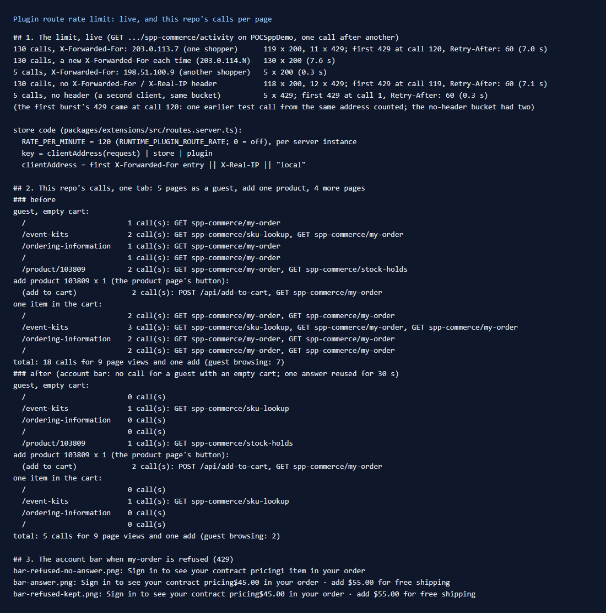

# 166: Are plugin routes rate-limited?

**Listed:** No, marked Blocked. **Result here:** Yes, confirmed live. The store now allows **120 calls a minute per
shopper address, store and plugin**, then answers `429 Too many requests` with `Retry-After: 60`. Another address is
not affected. There are two gaps, both in how the store tells shoppers apart. The example change reduces this repo's own
calls per page, from **18 to 5** over a nine-page browse, and keeps the account bar working through a 429.

## The limit, live

| 130 calls in about 7 s to `spp-commerce/activity` | Result |
|---|---|
| all with `X-Forwarded-For: 203.0.113.7` | 120 answered, then 429 (`Retry-After: 60`) |
| then 5 with `X-Forwarded-For: 198.51.100.9` | all answered |
| **each with a new `X-Forwarded-For`** | **all 130 answered** |
| with no `X-Forwarded-For` / `X-Real-IP` | 120 answered, then 429, and **a second client is refused from its first call** |

## Gaps (store code, `routes.server.ts`)

1. **The address comes from a header the client can send.** `clientAddress` takes the first `X-Forwarded-For`
   entry. Most proxies append the real address to whatever the client sent, so the first entry is the client's own
   value. Anyone can change it on every call, and the limit never applies. Behind a load balancer, use the entry it
   adds (the last one, or the proxy's own trusted header), or have the edge overwrite the header.
2. **Without the header, everyone shares one bucket** (`"local"`). A store reached directly, or behind a proxy that
   sets neither header, gives all shoppers 120 calls a minute in total. One busy client then locks everyone out of the
   plugin's routes, including the overridden `/api/add-to-cart` and `/api/place-order`, which run as plugin routes.
3. **Per server instance:** with several instances behind a load balancer, the real limit is 120 times the instance
   count. The store's comment says so too ("the edge still sets the real limit").

**What this means for a B2B store:** buyers at one company often share one office address, and so share one bucket.
At 1-2 calls per page view (before this change), 120 calls is 60-120 page views a minute for the whole office.

## The change: fewer calls, and no blank bar on a 429

`src/commerce/slots/AccountBar.tsx` (the account bar with the free-shipping meter) asked `my-order` on every page view.
With an item in the cart it asked twice: the cart count starts at 0 and then becomes 1. Now:

- **a guest with an empty cart** gets no call: there is nothing to total, and the sign-in prompt needs no data;
- **the answer is reused for 30 s** for the same cart count and sign-in (`sessionStorage`, this tab), so moving between
  pages costs no call. A change of the cart or the sign-in asks again;
- **when a call fails or is refused (429)**, the last answer stays on screen.

| One tab: 5 pages as a guest, add one product, 4 more pages | Before | After |
|---|---|---|
| plugin-route calls while browsing as a guest | 7 | 2 (`sku-lookup` on the kits page, `stock-holds` on the product page) |
| the add (`/api/add-to-cart` and the bar's refresh) | 2 | 2 |
| browsing with one item in the cart | 9 (the bar twice per page) | 1 |
| **total** | **18** | **5** |

On a 429 (simulated in the browser), the bar of a tab that has an answer keeps showing it. A new tab with no answer
yet shows the item count without the total, which is what every 429 looked like before:

| Answer (fresh) | Stale and refused: kept | Refused, no answer yet |
|---|---|---|
|  |  |  |

## How it renders

**In the webstore (base):** `/api/extensions/plugins/<pkg>/<route>` → `runPluginRoute` (`routes.server.ts`). This
looks up the store's plugin and checks `overRate(address|store|plugin)` before calling the handler. A store route
overridden by a plugin is rewritten by the proxy to the same route, so the same limit applies
([§7 B.4](../../RENDER-FLOW.md#7-cart-checkout-place-order)).

**How this customization joins it:** spp-commerce's browser slots call its routes (`my-order`, `sku-lookup`,
`stock-holds`, `delivery-estimate`). The account bar (`layout.header`) is on every page, which made it the largest
user of the shared limit ([§8](../../RENDER-FLOW.md#8-header-footer-search)).

End-to-end flow, with file and line references in the webstore: [docs/RENDER-FLOW.md](../../RENDER-FLOW.md).

## Where

- `src/commerce/slots/AccountBar.tsx`: `useMyOrder(count, signedIn)`, the 30 s answer and the guest skip

## How a client does this

Count your package's route calls per page view (a browser's network panel, filtered on `/api/extensions/plugins/`).
Call only when the page has something to show, reuse answers, and keep the last answer on a 429. In production, make sure
the edge sets `X-Forwarded-For` or `X-Real-IP` to the real client address, and overwrites what the client sent.
