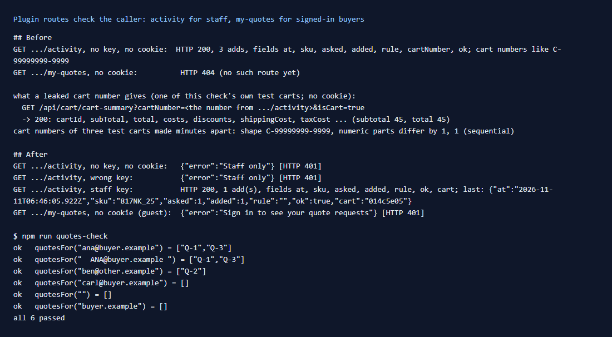

# 167: Do plugin routes check who the shopper is?

**Listed:** Partial. **Result here:** Partial, confirmed. The store tells a route who is calling, but leaves the check to
the route. Each route gets `context.user`, the signed-in buyer from the server-side session (a browser cannot make it
up), or `null` for a guest. The store itself requires nothing.

Auditing this repo's 16 routes against that found one that should have checked and didn't: **`activity` was public
and listed other shoppers' cart numbers.** On this store a cart number is the only key to a guest cart, and the
numbers are sequential. Fixed: `activity` is staff-only, and it no longer keeps cart numbers. A new route, `my-quotes`,
answers 401 without a signed-in buyer.

## What was wrong

- `GET .../spp-commerce/activity` (added in row 080 to show what the cart rules did) answered anyone. It returned the
  store's last 20 adds, each with its `cartNumber`.
- The store's own `GET /api/cart/cart-summary?cartNumber=…` answers whoever sends a cart number. The check used one of
  its own test carts, taken from `activity`, from a client with no cookie: **200, the cart's subtotal, total, taxes and
  shipping**.
- Cart numbers look like `C-99999999-9999`. Three test carts made minutes apart are **consecutive** (+1, +1). So the
  activity list made reading recent carts trivial, and even without it the numbers can be guessed. No other shopper's
  cart was read in this check.

**For the store team (not changed here):** `cart-summary` (and any route taking `cartNumber` from the browser) should use
the shopper's own cart from the session or cookie, or check that the number matches it. Cart numbers should be random,
not sequential.

## The change (`src/commerce/server.ts`, `src/commerce/quotes.ts`)

- **`activity` is staff-only:** it needs `X-Staff-Key`, compared in constant time like the quote list, and answers
  `401 {"error":"Staff only"}` otherwise.
- **No cart numbers kept:** `record()` replaces each entry's cart number with a tag, the first 8 hex digits of
  SHA-256 with a key made when the process starts (`"cart": "014c5e05"`). Entries of one cart still group together,
  and the tag is useless outside the process.
- **`my-quotes`** (new): a signed-in buyer's own quote requests. A guest gets
  `401 {"error":"Sign in to see your quote requests"}`. A buyer gets only the requests sent with the email they sign in
  with (`quotesFor`: Znode's user name, case-insensitive; none for an empty name).
- **`npm run quotes-check`** (`scripts/quotes-check.mts`, new): 6 cases for `quotesFor`, all passing. The signed-in
  path was not run live, because that needs a buyer's sign-in, and this check never signs in.

| | Before | After |
|---|---|---|
| `activity`, no key | 200, 3 adds with full cart numbers | 401 Staff only |
| `activity`, staff key | (same) | 200, entries with `cart` tags, no cart number |
| `my-quotes`, guest | (no such route) | 401 Sign in to see your quote requests |

## Every route in this repo, and who may call it

| Route | Who | How it checks |
|---|---|---|
| spp-commerce `activity` | staff | `X-Staff-Key` (now) |
| spp-commerce `quote-requests` | staff | `X-Staff-Key` (row 099) |
| spp-commerce `erp-stock` | the ERP | HMAC signature of the body (row 091) |
| spp-commerce `my-quotes` | a signed-in buyer, their own | `context.user` (now) |
| spp-commerce `my-order` | the shopper, their own cart | `context.cartNumber` from their cookie, `context.user` |
| spp-commerce `add-to-cart`, `place-order` (overrides) | the shopper, their own cart | the store's route with their cookies (`original()`) |
| spp-commerce `quote-request` (override of contact-us) | anyone (a contact form) | checks the form; kept per store, listed only to staff |
| spp-commerce `rep` | anyone (a rep's link) | known rep codes only; redirects only on this store (row 163) |
| spp-commerce `sku-lookup`, `search-typeahead` | anyone | the catalog at the caller's own prices (the store's headers for that shopper) |
| spp-commerce `delivery-estimate`, `stock-holds` | anyone | public information |
| theme `highlights`, `shipping-cutoff`, `store-status` | anyone | public information |

## How it renders

**In the webstore (base):** `runPluginRoute` → `routeContext` (`routes.server.ts`) reads the saved session
(`getSavedUserSession`) and passes `user` (id, name, account, role, permission code, budget) or `null`, with the cart
number from the shopper's cookie. It calls the route whoever the caller is.

**How this customization joins it:** spp-commerce's routes decide for themselves: the staff key for staff lists,
`context.user` for a buyer's own data, an HMAC for the ERP
([§7 B.4](../../RENDER-FLOW.md#7-cart-checkout-place-order)).

End-to-end flow, with file and line references in the webstore: [docs/RENDER-FLOW.md](../../RENDER-FLOW.md).

## Where

- `src/commerce/server.ts`: `activityList`, `myQuotes`, `cartTag` in `record()`
- `src/commerce/quotes.ts`: `quotesFor`
- `scripts/quotes-check.mts` (new), `package.json` (`npm run quotes-check`), README commands table
- `docs/scenarios/080-before-after-add-to-cart/README.md`: the activity route is staff-only now

## How a client does this

Decide for every route who may call it, and check it first in the route: `context.user` for a buyer's own data, a key
or a signature for staff and systems. Never return identifiers that unlock another shopper's data: cart numbers,
order numbers, emails.
