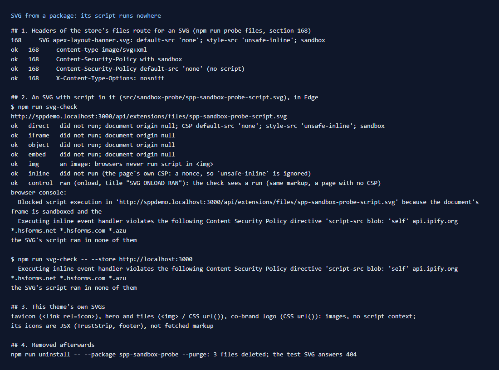
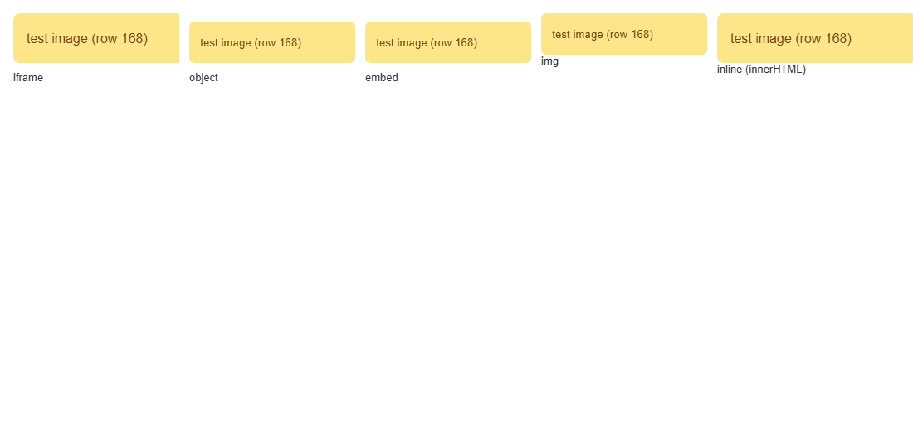

# 168: Are SVG files from packages blocked from running script?

**Listed:** Partial. **Result here:** Yes, confirmed in a browser, not just from the headers. An SVG with script in it,
served from the store's files route, ran its script in none of six ways of loading it. A control (the same markup in a
page with no CSP) did run, so the check can see a run when there is one.

The test image in a store page as `<iframe>`, `<object>`, `<embed>`, `` and inlined with `innerHTML`. It shows
in all five, and its script ran in none:

## What was checked (`npm run svg-check`)

The test image (`src/sandbox-probe/spp-sandbox-probe-script.svg`, shipped in the test package from row 165) has an
`onload` attribute and a `<script>`. If either runs, it marks the document and changes its title.

| How the SVG is loaded | Result | Why |
|---|---|---|
| opened directly (a link, a new tab) | did not run; document origin `null` | the route sends `Content-Security-Policy: default-src 'none'; style-src 'unsafe-inline'; sandbox` |
| `<iframe src>` in a store page | did not run; origin `null` | the same header: a sandboxed document with no script |
| `<object data>` | did not run; origin `null` | the same |
| `<embed src>` | did not run; origin `null` | the same |
| `` | no script | browsers never run script in an image |
| its markup inlined with `innerHTML` | did not run | the **page's** CSP has a nonce, so its `'unsafe-inline'` is ignored and the inline `onload` is refused |
| control: the same markup, a page with no CSP | **ran** | proves the check sees a run |

The browser's console confirms both blocks: "Blocked script execution … because the document's frame is sandboxed" and
"Executing inline event handler violates the following Content Security Policy directive 'script-src …'". The results
are the same on POCSppDemo and MaxwellsHardware. The probe from row 160 also checks the headers on every run:
`image/svg+xml`, CSP with `sandbox` and `default-src 'none'`, and `X-Content-Type-Options: nosniff`.

## Notes

- **Inlining depends on the page's CSP.** An SVG put into the page as markup is protected by the store page's nonce,
  not by the files route. The page's `script-src` also allows `'unsafe-eval'` and several whole CDNs (`*.jsdelivr.net`
  among them, which serves any npm package). That doesn't matter for SVG, but it weakens the page's CSP against injected
  `<script src>` in general. That is store configuration.
- **Opened directly, the SVG renders without outside resources**: `default-src 'none'` also blocks images and fonts it
  links. Inside an ``, browsers never load them anyway.
- **This theme's own SVGs** are only used as images: the favicon (`<link rel="icon">`), the hero and tiles (``),
  the co-brand logo (CSS `url()`). Its icons are JSX in its components, not fetched markup.
- The test package was uninstalled afterwards, and the test SVG answers 404.

## How it renders

**In the webstore (base):** `serveRuntimeFile` (`files-route.server.ts`) adds the sandboxing CSP to every
`image/svg+xml` answer, and `X-Content-Type-Options: nosniff` to every file. The page itself gets the store's CSP with a
per-request nonce (the proxy).

**How this customization joins it:** the theme links its SVG assets through that route with `asset()` (`?v=` version,
row 145) and shows them as images ([§3 B.1](../../RENDER-FLOW.md#3-the-page-shell-root-layout-head-styles-labels-server-layout)).

End-to-end flow, with file and line references in the webstore: [docs/RENDER-FLOW.md](../../RENDER-FLOW.md).

## Where

- `scripts/svg-check.mjs` (new), `package.json` (`npm run svg-check`), README commands table
- `src/sandbox-probe/spp-sandbox-probe-script.svg` (new test image), `spp-sandbox-probe.znode-package.json` (`assets`)

## How a client does this

Use package SVGs as images (``, CSS). Don't inline fetched SVG markup into the page; if you must, sanitize it.
Re-run `npm run svg-check` with a test SVG after a store upgrade.
