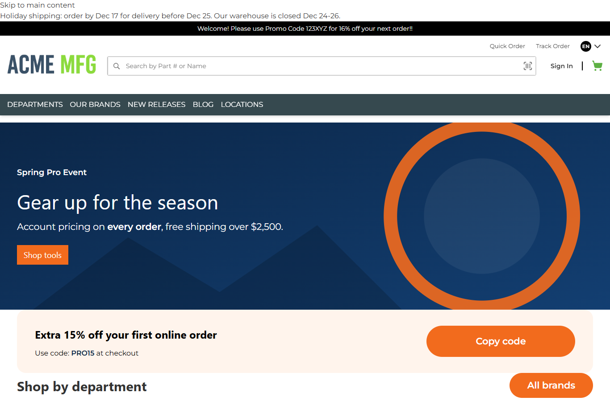
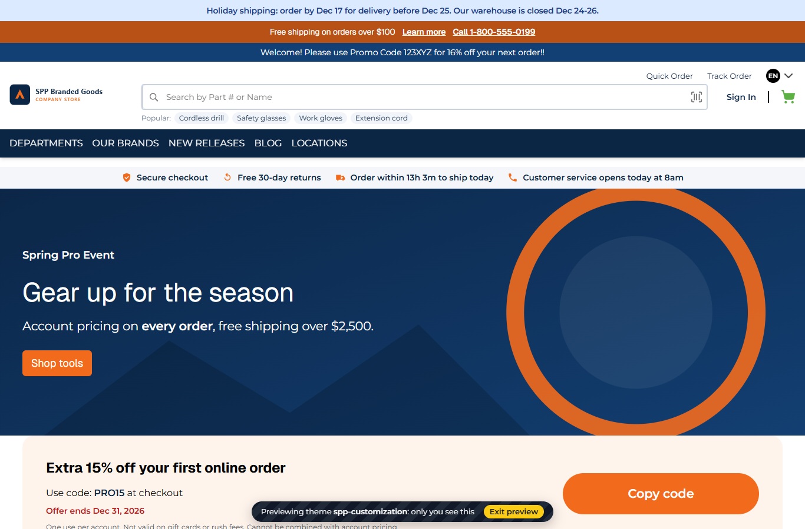
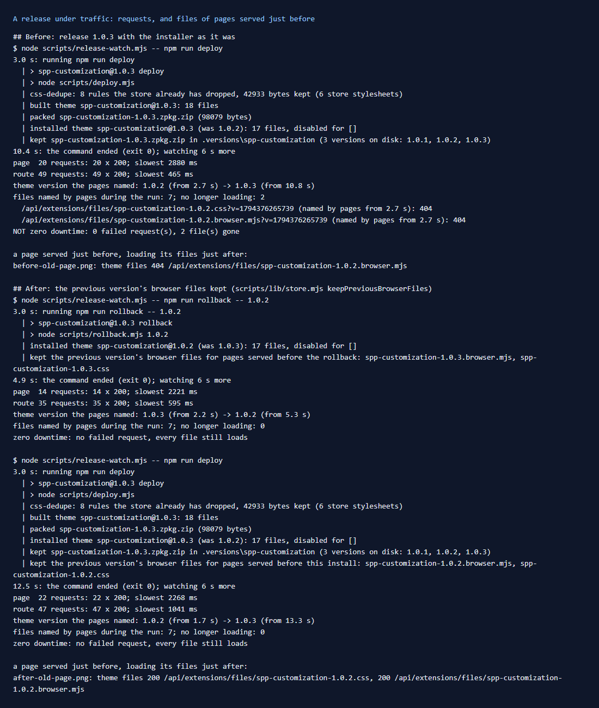

# 173: Can packages be updated with zero downtime?

**Listed:** Yes. **Result here:** Yes now. Before this change it was only "almost". A release under steady traffic
never failed a request: no restart, no 5xx, no slow-down beyond the usual. But the installer deletes the previous
version's browser bundle and stylesheet, so a page served a moment before a release asked for files that were gone,
and showed without the theme. `npm run deploy` and `npm run rollback` now put the previous version's browser files back
right after the install, and a release under traffic left nothing broken.

| A page served just before the release, its files loaded just after | |
|---|---|
| Before: `spp-customization-1.0.2.browser.mjs` and `.css` answer 404, and the page shows without the theme |  |
| After: both answer 200, and the page shows as served |  |

## The example: release 1.0.3

The theme went from 1.0.2 to **1.0.3**, the release that carries row 148's header fix. The version is in
`znode-package.json`, `package.json`, `ASSET_VERSION` and every `?v=` (row 145's deploy check enforces it).

## What was measured (`npm run release-watch -- -- <command>`)

`scripts/release-watch.mjs` (new) requests the theme's home page twice in parallel, and its `store-status` route, every
150 ms, from 3 s before the command until 6 s after it. It records every status and the slowest answer, and which theme
version each page named. At the end it fetches every bundle and stylesheet URL that any of those pages named.

| | Requests | Failed | Files named by pages that no longer load |
|---|---|---|---|
| Before: `npm run deploy` (1.0.2 → 1.0.3) | 20 pages, 49 route calls | 0 | **2**: `spp-customization-1.0.2.css`, `.browser.mjs` |
| After: `npm run rollback -- 1.0.2` (1.0.3 → 1.0.2) | 14 pages, 35 route calls | 0 | 0 |
| After: `npm run deploy` (1.0.2 → 1.0.3) | 22 pages, 47 route calls | 0 | 0 |

Pages switched versions between two requests (for example "1.0.2 from 1.7 s → 1.0.3 from 13.3 s"). The store
re-reads the registry by its modification time, with no restart (row 8).

## Why files went missing

`znode install` replaces a package's files: the new version's bundle, stylesheet and server part go in, and the old
version's are deleted. The page HTML names its files with the version (`spp-customization-1.0.2.browser.mjs?v=…`). A page
rendered before the install still names the old files, and its browser fetches them after it. The same applies to a
page reopened from the browser's back-forward cache, and to an HTML response held by a CDN.

## The change

- **`scripts/lib/store.mjs`: `keepPreviousBrowserFiles(name, current, previous)`** (new). After an install, it
  restores the previous version's `*.browser.mjs` and `*.css` from its kept zip (`.versions/`, row 9), and deletes those
  of any version before that. Only browser files come back, never a server part: the store serves them by name (row 160
  blocks `.server.mjs`), and nothing loads them on the server.
- **`scripts/deploy.mjs`** and **`scripts/rollback.mjs`** note the installed version before installing, and call it
  after. It works for every package of this repo (`npm run deploy -- spp-commerce.znode-package.json` too).
- `npm run uninstall` still removes everything: its "older versions' files" rule covers the kept ones.

**What's left:** between the installer deleting the files and the script putting them back there is a moment
(milliseconds, the time to copy the zip). The store's installer could keep the previous version's browser files itself,
which would close it. An old browser bundle runs against the new server part. That suits a release whose routes keep
their shape, which is the usual case for a theme.

## How it renders

**In the webstore (base):** the installer (`znode install`) replaces the package's files and writes `plugins.json`.
The store reads the new registry on the next request, and its manifest names the new files with `?v=<install time>`
([§1](../../RENDER-FLOW.md#1-from-this-repository-to-the-store-install-registry)). Files are served by name with no
registry check ([§3 B.1](../../RENDER-FLOW.md#3-the-page-shell-root-layout-head-styles-labels-server-layout)).

**How this customization joins it:** this repo's deploy and rollback scripts wrap the installer and keep one version of
browser files behind it.

End-to-end flow, with file and line references in the webstore: [docs/RENDER-FLOW.md](../../RENDER-FLOW.md).

## Where

- `scripts/lib/store.mjs`: `keepPreviousBrowserFiles`, `installedVersion`
- `scripts/deploy.mjs`, `scripts/rollback.mjs`
- `scripts/release-watch.mjs` (new), `package.json` (`npm run release-watch`), README commands table
- the 1.0.3 release: `znode-package.json`, `package.json`, `src/lib/assets.ts`, `src/styles/fonts.css`,
  `src/pages/home.json`

## How a client does this

Release with `npm run deploy` (or roll back with `npm run rollback -- <version>`), which keeps the previous browser files.
Check a release with `npm run release-watch -- -- npm run deploy`: 0 failed requests and 0 missing files.
