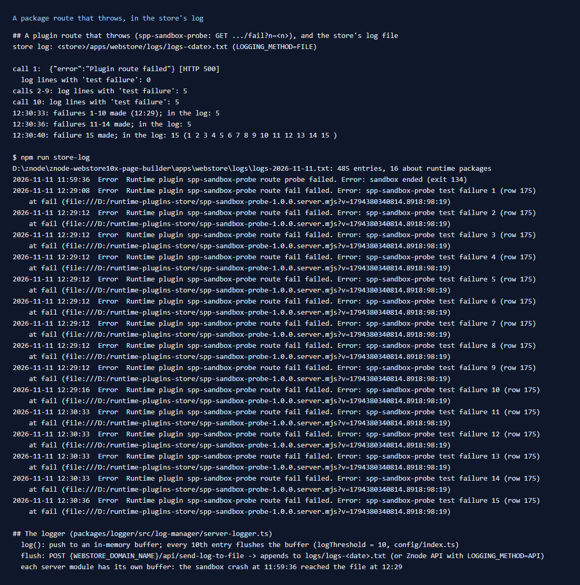

# 175: Are package errors logged on the server?

**Listed:** Yes. **Result here:** Yes, but late. A plugin route that throws is answered `500 {"error":"Plugin route
failed"}`, and the store logs an entry that names the package, the route and the error, with the line in the installed
bundle. The store writes its log **ten entries at a time**, so an error can sit in memory for a long time. In this
check, failures 1-5 reached the file after the 9th call, failures 6-10 only with the 15th, and a sandbox crash at
11:59 was written at 12:29. After a restart, entries still in memory are lost.



## What was checked

The test package (`spp-sandbox-probe`, rows 165 and 168) got a route that always throws:
`GET .../spp-sandbox-probe/fail?n=<n>` → `Error: spp-sandbox-probe test failure <n>`. It was installed on POCSppDemo,
called 15 times, and the log file was read after each step:

| After | Entries in `logs/logs-2026-11-11.txt` |
|---|---|
| failure 1 | 0 |
| failures 2-9 | 5 (failures 1-5, written together with the sandbox crash from 11:59) |
| failure 10, then 11-14 | still 5 |
| failure 15 | 15 |

Each entry:

```
Timestamp: 2026-11-11 12:29:08
Level: Error
Area: Webstore_System
Message: Runtime plugin spp-sandbox-probe route fail failed. Error: spp-sandbox-probe test failure 1 (row 175)
    at fail (file:///D:/runtime-plugins-store/spp-sandbox-probe-1.0.0.server.mjs?v=…:98:19)
```

## Why it is late

`logServer` (`packages/logger/src/log-manager/server-logger.ts`) pushes each entry to an in-memory buffer and flushes
it every tenth entry (`logThreshold = 10`). A flush posts the buffer to the store's own `/api/send-log-to-file`, which
appends to `logs/logs-<date>.txt` (or to Znode's log API with `LOGGING_METHOD=API`). In development every server module
has its own copy of the logger, so the plugin route runner fills its buffer only with its own entries. Plugin errors
are rare, so they wait.

**For the store team:** flush errors at once (or on a timer), and on shutdown. Until then, a package error you are
looking for may simply not be in the file yet.

## The change: `npm run store-log`

The store's log is long (475 entries today, mostly cart and header info). `scripts/store-log.mjs` (new) finds the
store from `tsconfig.store.json` (written by `npm run link-store`) or `STORE_DIR`. It lists only the entries about
runtime packages: failed routes, cart hooks, request hooks, server slots and pages, packages skipped at load, an
unreadable registry. For each, it prints the line of the package bundle where the error happened (`--all-lines` for
the whole stack, `--package <name>` for one package, `--date` for another day).

```
2026-11-11 12:29:08  Error  Runtime plugin spp-sandbox-probe route fail failed. Error: spp-sandbox-probe test failure 1 (row 175)
    at fail (file:///D:/runtime-plugins-store/spp-sandbox-probe-1.0.0.server.mjs?v=1794380340814.8918:98:19)
```

The line points into the built bundle. Row 183 maps it back to the TypeScript source.

## How it renders

**In the webstore (base):** `runPluginRoute` (`routes.server.ts`) catches the route's error, logs
`Runtime plugin <name> route <route> failed. <stack>` and answers 500. Cart hooks (`cart-hooks.server.ts`), request
hooks, server slots (`RuntimeServerSlot.tsx`) and server pages (`RuntimeServerPage.tsx`) log the same way. A failing
browser slot is logged from the browser (row 184).

**How this customization joins it:** this repo's routes run inside that `try`
([§7 B.4](../../RENDER-FLOW.md#7-cart-checkout-place-order)). A thrown error never reaches the shopper as a stack, only
as the 500 above.

End-to-end flow, with file and line references in the webstore: [docs/RENDER-FLOW.md](../../RENDER-FLOW.md).

## Where

- `scripts/store-log.mjs` (new), `package.json` (`npm run store-log`), README commands table
- `src/sandbox-probe/server.ts`: the `fail` route (test package)

## How a client does this

After a release, run `npm run store-log -- --package <name>`. When an error is missing, remember the batches of ten:
check again later, or after more traffic. In production, send the store's logs to the API (`LOGGING_METHOD=API`), and
ask for errors to be flushed at once.
