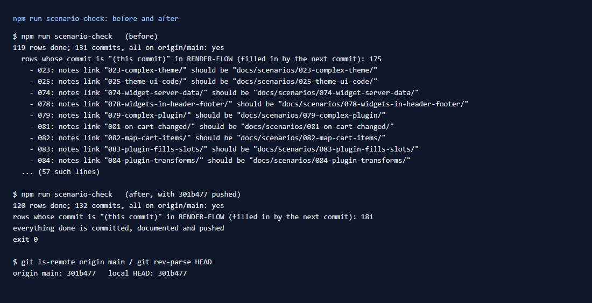

# 181: Is the work committed and pushed?

**Listed:** Partial. **Result here:** Yes, and now checkable with one command. Every scenario marked Done has:

- a commit, pushed to https://github.com/mayur-mate-amla/spp-customization;
- a notes folder whose README has a "How it renders" section, and whose images exist;
- a row in the `docs/RENDER-FLOW.md` table naming its commit.

The first run of the new check found one real problem: **57 of the "notes" links in `SCENARIOS.md` were broken**
(`[notes](023-complex-theme/)`, which leads nowhere from the repository root). They are fixed.

## What `npm run scenario-check` checks

`scripts/scenario-check.mjs` (new) reads `SCENARIOS.md`, and for each row marked ✅ Done checks:

1. a `docs/scenarios/<nnn>-<slug>/` folder exists, and the row's notes link points at it;
2. its `README.md` exists and has a `## How it renders` section;
3. every image the README shows exists;
4. `docs/RENDER-FLOW.md` §10 has a row for it, and every commit hash there exists in this repository and is on
   `origin/main` (pushed). A row still reading "(this commit)" is listed; the next commit fills it in.

Then it checks the repository: no uncommitted changes, nothing ahead of `origin/main`. It exits with 1 on any problem.
`--fix-links` rewrites notes links to `docs/scenarios/<folder>/`.

## Before and after

**Before** ([before.txt](before.txt)): 119 rows done, 131 commits, all on `origin/main`. All READMEs, sections, images
and commits were there, but 57 notes links were relative to the wrong folder. Rows 001-022 had the full path. From 023
on, the helper that marks rows wrote only the folder name.

**After** ([output.txt](output.txt), run after this commit was pushed): no problem. The links are fixed by
`--fix-links`, and the helper that marks rows now writes the full path.

## How it renders

**In the webstore (base):** nothing. This is the repository's own bookkeeping.

**How this customization joins it:** every scenario's commit changes the code or configuration, its notes folder, its
row in `SCENARIOS.md` and its row in the RENDER-FLOW table ([§10](../../RENDER-FLOW.md#10-every-scenario-its-commits-and-where-it-acts)).
The check keeps those four in step.

End-to-end flow, with file and line references in the webstore: [docs/RENDER-FLOW.md](../../RENDER-FLOW.md).

## Where

- `scripts/scenario-check.mjs` (new), `package.json` (`npm run scenario-check`), README commands table
- `SCENARIOS.md`: 57 notes links fixed

## How a client does this

Run `npm run scenario-check` before handing work over: it fails on anything uncommitted, unpushed or undocumented.
