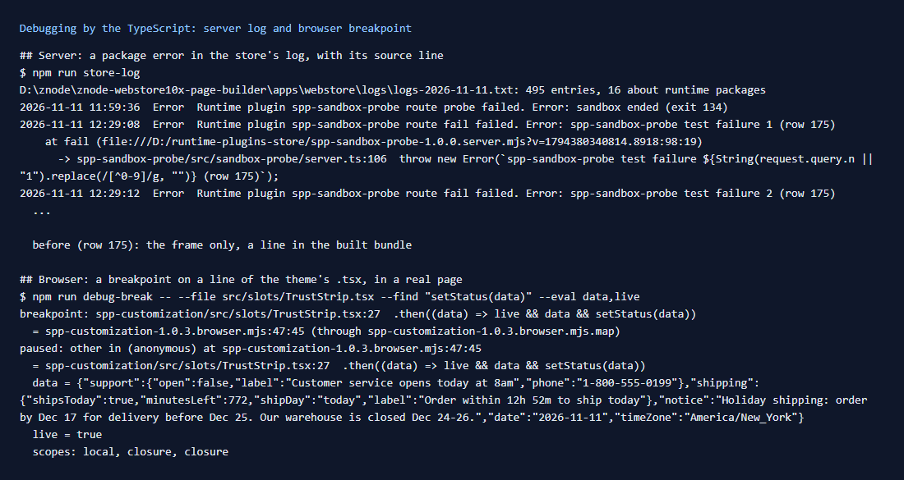

# 182: Is debugging working?

**Listed:** Partial. **Result here:** Yes, by the TypeScript, on both sides:

- **Browser:** a breakpoint on line 27 of `src/slots/TrustStrip.tsx` paused the theme in a real page, and read the
  local values: the store status the strip had just received, and `live = true`.
- **Server:** each package error in the store's log now shows the `src/` line it came from, read through the source
  maps of row 183.

Before, a server error pointed at a line in the built bundle. Devtools showed compiled JavaScript from a folder the
build deletes.



## Server: `npm run store-log`

`scripts/store-log.mjs` (row 175) now follows each stack frame in a package bundle through its map
(`sourceAt` in `scripts/lib/source-maps.mjs`):

```
2026-11-11 12:29:08  Error  Runtime plugin spp-sandbox-probe route fail failed. Error: spp-sandbox-probe test failure 1 (row 175)
    at fail (file:///D:/runtime-plugins-store/spp-sandbox-probe-1.0.0.server.mjs?v=…:98:19)
      -> spp-sandbox-probe/src/sandbox-probe/server.ts:106  throw new Error(`spp-sandbox-probe test failure …`);
```

For one stack line from anywhere (a monitoring tool, a support ticket): `npm run source-at -- "<stack line>"`.
The installed bundle's map is used, so resolve a line before the next release of that package. Otherwise use the map
of the zip kept in `.versions/`.

The store's own process runs without `--inspect` here, so a live server debugger was not attached. Server code is
debugged through the log and the maps. Its routes and helpers are plain functions, and this repo's checks call them
directly (`npm run secrets-check`, `npm run quotes-check`).

## Browser: `npm run debug-break`

`scripts/debug-break.mjs` (new) does what clicking a line number in devtools' Sources panel does, without a person:

1. finds the line in the `.tsx` (`--find "setStatus(data)"` → `TrustStrip.tsx:27`);
2. turns it into the bundle position through the map (`spp-customization-1.0.3.browser.mjs:47:45`);
3. sets the breakpoint in Edge (`Debugger.setBreakpointByUrl`), opens the page, and waits for the pause;
4. maps the paused place back to the source, and evaluates `--eval` expressions in that frame.

```
breakpoint: spp-customization/src/slots/TrustStrip.tsx:27  .then((data) => live && data && setStatus(data))
paused: other in (anonymous) at spp-customization-1.0.3.browser.mjs:47:45
  = spp-customization/src/slots/TrustStrip.tsx:27
  data = {"support":{"open":false,"label":"Customer service opens today at 8am",…},"shipping":{"label":"Order within 12h 52m to ship today",…},…}
  live = true
```

A person does the same in devtools: Sources → `spp-customization/src/slots/TrustStrip.tsx` → click line 27.

## How it renders

**In the webstore (base):** the store loads each browser bundle by URL. The browser follows its
`//# sourceMappingURL=` to the map served next to it. Server bundles are imported by the store's Node process, and their
errors go to the store's log ([§3 B.1](../../RENDER-FLOW.md#3-the-page-shell-root-layout-head-styles-labels-server-layout)).

**How this customization joins it:** the theme's `layout.header` slot renders `TrustStrip`, whose effect fetches the
`store-status` route. That is where the breakpoint paused
([§8 B](../../RENDER-FLOW.md#8-header-footer-search)).

End-to-end flow, with file and line references in the webstore: [docs/RENDER-FLOW.md](../../RENDER-FLOW.md).

## Where

- `scripts/store-log.mjs`: source line per frame
- `scripts/lib/source-maps.mjs`: `sourceAt`, `bundlePosition`; `scripts/source-at.mjs` uses them
- `scripts/debug-break.mjs` (new), `package.json` (`npm run debug-break`), README commands table

## How a client does this

In the browser, open devtools → Sources → `<package>/src/...` and set breakpoints in the TypeScript. On the server, read
errors with `npm run store-log -- --package <name>`, or one stack line with `npm run source-at -- "<line>"`.
