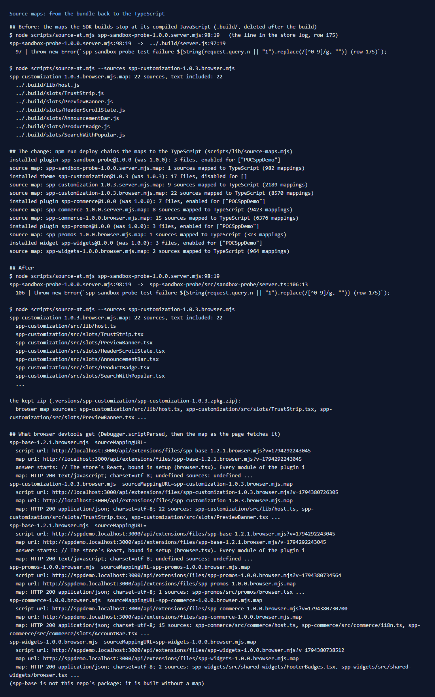

# 183: Are there source maps for package code?

**Listed:** No. **Result here:** Yes now, and they lead to the TypeScript. The SDK did build and install a map for
every bundle, but those maps stopped at its own compiled JavaScript, in a folder it deletes after the build. A stack
line led to `../.build/server.js:97`, and devtools showed compiled code. `npm run deploy` now chains each map back to
this repo's sources. The same line leads to `src/sandbox-probe/server.ts:106`, and devtools lists
`spp-customization/src/slots/TrustStrip.tsx` with its text.

| The error logged in row 175, `spp-sandbox-probe-1.0.0.server.mjs:98:19` | Leads to |
|---|---|
| Before | `../.build/server.js:97:19`, a compiled file that no longer exists (its text is in the map) |
| After | `spp-sandbox-probe/src/sandbox-probe/server.ts:106:13`, the `throw` line as written |

## Why the maps stopped short

The SDK (`znode-plugin/lib/znode-package.mjs`) builds in two steps:

1. `transpileSources`: each `.ts`/`.tsx` compiled to `.js` in `.build/` with `ts.transpileModule`, **with no source
   map**;
2. rollup bundles `.build/<entry>.js` with `sourcemap: true`.

The bundle's map can only point at what rollup saw, the compiled files, and the step back to the source was never
recorded. JSX files compile with one more line at the top (the `react/jsx-runtime` import), so even the line numbers
were off by one.

## The change

- **`scripts/lib/source-maps.mjs`** (new), `chainSourceMaps(manifest, pluginFolder)`:
  - compiles each source again exactly as the SDK does (same TypeScript 5.9 options), this time with a map;
  - checks the output is identical to the compiled text inside the bundle's map, and leaves a map as built if not, so
    a wrong mapping is never written;
  - composes bundle → compiled → source (`source-map` 0.6);
  - names the sources `<package>/src/...` and includes their text.

  It rewrites the maps in `dist*/`, inside the release zip (so `.versions/` and rollbacks get them), and in the plugin
  folder.
- **`scripts/deploy.mjs`** calls it after `znode deploy`, for every package of this repo: all 7 maps chained (theme
  server and browser, spp-commerce server and browser, spp-promos, spp-widgets, the test package). Every compiled
  file matched.
- **`scripts/source-at.mjs`** (new): `node scripts/source-at.mjs <bundle>.mjs:<line>:<column>` (or a whole stack
  line) prints the source position and line, and `--sources <bundle>.mjs` lists a map's sources.

## In the browser

On the theme's home (MaxwellsHardware, previewed) and on POCSppDemo, Edge's debugger reported each of this repo's
bundles with `sourceMappingURL=<bundle>.map`. The map loads from the files route (`200 application/json`) and lists
the `.tsx` sources, for example `spp-commerce/src/commerce/slots/AccountBar.tsx`. Devtools' Sources panel shows those
files, and breakpoints and console stack traces use them.

**Note:** browser maps are public, like the bundles. They carry the sources, comments included. Write nothing in
browser code's comments you would not publish. Server maps are never served (row 160).

## How it renders

**In the webstore (base):** the files route serves `.map` files (`application/json`) next to the bundles, but never a
server bundle's map ([§3 B.1](../../RENDER-FLOW.md#3-the-page-shell-root-layout-head-styles-labels-server-layout)).
The browser follows the bundle's `//# sourceMappingURL=` comment.

**How this customization joins it:** the bundles and maps the store serves are this repo's build output, with the
maps now chained to `src/`.

End-to-end flow, with file and line references in the webstore: [docs/RENDER-FLOW.md](../../RENDER-FLOW.md).

## Where

- `scripts/lib/source-maps.mjs` (new), `scripts/deploy.mjs`
- `scripts/source-at.mjs` (new)

## How a client does this

Deploy with `npm run deploy` (which chains the maps). Read a production stack line with
`node scripts/source-at.mjs "<stack line>"`.
