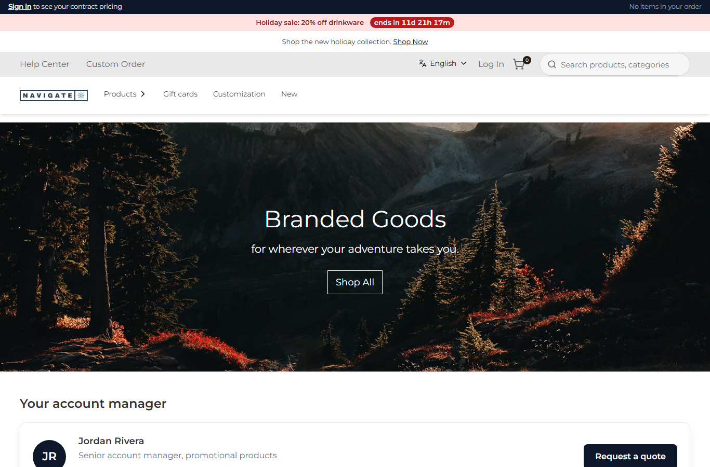
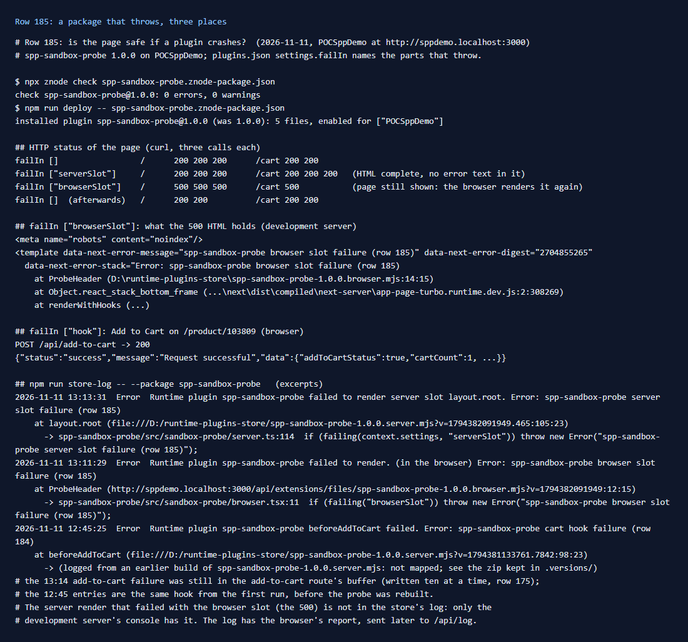
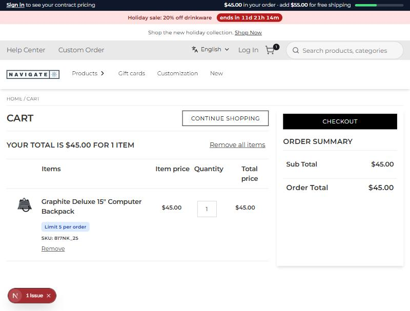

# 185: Is the page safe if a plugin crashes?

**Listed:** Yes. **Result here:** Partial. The shopper always got a working page, but not in the same way in all
three places:

| Where the package throws | Page | HTTP | In the store's log |
|---|---|---|---|
| Server slot (`layout.root`, around every page) | the same as without the package | 200 | yes, with the `server.ts` line |
| Cart hook (`beforeAddToCart`) | the item is added (`addToCartStatus: true`) | 200 | yes, ten entries at a time (row 175) |
| Browser slot (`layout.header`) | shown, after the browser renders the whole page again | **500** | only the browser's report, sent afterwards |

A browser slot that throws breaks the **server** render of every page with that slot. The store renders browser
bundles on the server too, so the HTML already holds the header, and React error boundaries do not work there. The
browser then renders the page again and the store's `SlotBoundary` catches the error, so the shopper sees the page.
But the response is a 500 with `<meta name="robots" content="noindex">`, and in development the HTML carries the error
and its stack with server paths. "Products" in the nav also lost its chevron in that render. The production build was
not tried here.




## What was checked

The test package `spp-sandbox-probe` (rows 165, 168, 175) gets a list setting, `failIn`, in `plugins.json`. Each part
throws when the list names it:

- `serverSlot`: `serverSlots["layout.root"]` in `src/sandbox-probe/server.ts`, which otherwise returns the page unchanged
- `hook`: `hooks.beforeAddToCart`, which otherwise returns the request unchanged
- `browserSlot`: the `layout.header` slot in `src/sandbox-probe/browser.tsx` (new), which otherwise renders the header unchanged

The probe was deployed to POCSppDemo (`npm run deploy -- spp-sandbox-probe.znode-package.json`, `znode check` 0 errors).
Each case was loaded at `http://sppdemo.localhost:3000` with curl and in a browser, then `failIn` was set back to `[]`.
Commands and output: [output.txt](output.txt).



**Server slot.** `RuntimeServerSlot` catches the error, logs it and keeps what was there before the package. Page and
cart: 200, complete HTML, no error text in it.


**Cart hook.** `request-hooks.server.ts` logs it and goes on with the request as it was. Add to Cart on the backpack
answered `{"addToCartStatus":true,"cartCount":1}` and the cart shows the line.



**Browser slot.** `/` and `/cart` answered 500 on every call, and 200 again once `failIn` was empty. The 500 page holds
`data-next-error-message="spp-sandbox-probe browser slot failure (row 185)"` and a stack starting at
`D:\runtime-plugins-store\spp-sandbox-probe-1.0.0.browser.mjs:14:15`. That is the browser bundle, run by the server.
In the browser, `SlotBoundary` leaves the header without the package and sends
`Runtime plugin spp-sandbox-probe failed to render.` to `/api/log`.


**For the store team:** catch a browser slot's error during the server render too, for example with a `<Suspense>`
around each `RuntimeSlot` so only that slot falls back to the browser, or with a server-side render of the slot inside
a `try`. Log that failure on the server as well. Also, `RuntimeSlot` passes its text to `logClient.error` as the
*area*, so the log's Area field says `Runtime plugin … failed to render.`.

## The change: `npm run store-log` lists browser entries

`scripts/store-log.mjs` read only the Message field, so it missed a browser slot's entry (the text is in Area). It now
reads both and marks the entry `(in the browser)`. The stack line is in the browser bundle, and the row 183 maps lead
back to `browser.tsx`:

```
2026-11-11 13:11:29  Error  Runtime plugin spp-sandbox-probe failed to render. (in the browser) Error: spp-sandbox-probe browser slot failure (row 185)
    at ProbeHeader (http://sppdemo.localhost:3000/api/extensions/files/spp-sandbox-probe-1.0.0.browser.mjs?v=1794382091949:12:15)
      -> spp-sandbox-probe/src/sandbox-probe/browser.tsx:11  if (failing("browserSlot")) throw new Error(…);
```

`scripts/lib/source-maps.mjs` also compares the `?v=` file time of a stack line with the installed bundle
(`sameBuild`). A line logged by an earlier build of the same version is no longer mapped to the wrong place: it says
`logged from an earlier build … not mapped`, and points at the zip kept in `.versions/`. The probe was rebuilt during
this check, which is how this was found.

## How it renders

**In the webstore (base):** the root layout wraps header to footer in `<RuntimeServerSlot name="layout.root">`, whose
`try` keeps the page when a package throws
([§3 B.4](../../RENDER-FLOW.md#3-the-page-shell-root-layout-head-styles-labels-server-layout)). The header is
`HeaderRender` → `RuntimeHeader` → `<RuntimeSlot name="layout.header">`. On the server, `useRuntimePlugins` imports
the same browser bundles (`client/runtime.ts:42`), so a throwing slot fails the server render, and `SlotBoundary`
only catches it in the browser ([§8 B](../../RENDER-FLOW.md#8-header-footer-search)). `POST /api/add-to-cart` runs
`beforeAddToCart` in `request-hooks.server.ts`, which logs and skips a hook that throws
([§6 B](../../RENDER-FLOW.md#6-add-to-cart)).

**How this customization joins it:** the probe uses the same three entry points as the theme and spp-commerce:
`layout.root` like `ThemeLayout.tsx`, `layout.header` like the theme's `AnnouncementBar`, and a cart hook. So a bug
in any of them in a browser slot gives the 500 above, and a bug on the server side is contained.

End-to-end flow, with file and line references in the webstore: [docs/RENDER-FLOW.md](../../RENDER-FLOW.md).

## Where

- `src/sandbox-probe/server.ts`: `layout.root` server slot and `beforeAddToCart` hook that throw on `failIn`
- `src/sandbox-probe/browser.tsx` (new): `layout.header` slot that throws on `failIn`
- `spp-sandbox-probe.znode-package.json`: browser build, `cartHooks` permission, `failIn` setting
- `scripts/store-log.mjs`: browser entries; `scripts/lib/source-maps.mjs`: `sameBuild`
- `docs/scenarios/185-page-survives-plugin-crash/` (README, output.txt, evidence.png, before.png, after.png,
  server-slot.png, browser-slot.png, cart-hook.jpg)

## How a client does this

Keep risky work in server slots and hooks: there a failure is contained and logged. In a browser slot, guard the
render yourself (`try` around data parsing, defaults for missing settings), because a throw there turns every page with
that slot into a 500. After a release, run `npm run store-log -- --package <name>` and look for `(in the browser)`
entries too.
