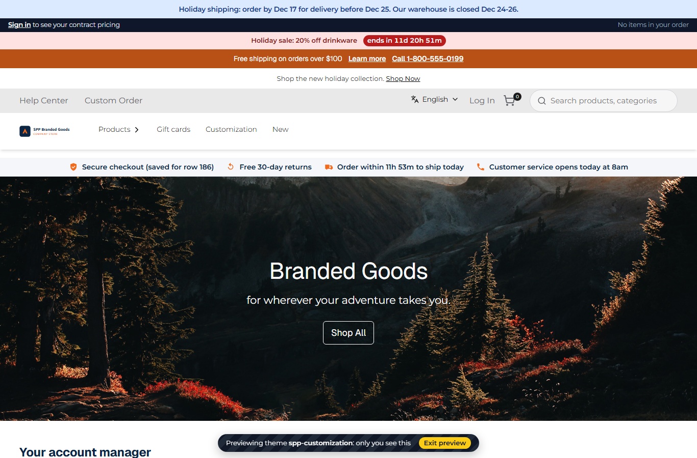

# 186: Is there hot reload while developing a package?

**Listed:** Partial. **Result here:** Partial. Save, wait a few seconds, refresh. `npm run dev` deploys on every save
(8 to 11 s here), and the next page load has the change under a new `?v=` URL. Nothing reloads an open page by itself
and nothing swaps code in place: the store has no live-reload channel for runtime packages.

The SDK's watcher (`znode dev`) had two gaps for this repository, fixed here with `scripts/dev.mjs`:

- **It always deployed the theme.** It deploys the folder, not the manifest it is given, so
  `npx znode dev spp-promos.znode-package.json` built and installed spp-customization.
- **It skipped this repository's deploy steps.** It runs the SDK's `deploy`, not `scripts/deploy.mjs`, so it chained
  no source maps back to `src/` (row 183) and kept no copy in `.versions/` for `npm run rollback` (row 010).

`npm run dev -- <manifest>` now watches that package's own folder (`src/promos/` for spp-promos, `src/` for the
theme) and runs `scripts/deploy.mjs <manifest>` on each save.

## What was checked

[output.txt](output.txt):

1. **Theme.** `npm run dev` (then still `znode dev .`) was running. Line 15 of `src/slots/TrustStrip.tsx` was saved at
   13:36:38, and the theme was installed at 13:36:49 (10.6 s). A browser tab open since before the save still showed
   "Secure checkout" 5 s after the install: same document, old text. Refreshed, it loaded the bundle under a new `?v=`
   and showed "Secure checkout (saved for row 186)".
2. **Companion manifest with the SDK.** `npx znode dev spp-promos.znode-package.json` built and installed the theme.
3. **Companion manifest with `scripts/dev.mjs`.** `npm run dev -- spp-promos.znode-package.json` deployed spp-promos,
   with its source map and a kept copy. Touching a theme file started nothing. Saving `src/promos/browser.tsx`
   deployed spp-promos in 8.0 s, and the refreshed page showed the new countdown text.

Both edits were restored and deployed again, so the packages are unchanged by this commit.

## How it renders

**In the webstore (base):** each request reads `plugins.json` by modification time, and the manifest in the page
carries every browser bundle as `/api/extensions/files/<file>?v=<mtime>`. A new install gives a new URL, which the next
page load fetches ([§1 step 3](../../RENDER-FLOW.md#1-from-this-repository-to-the-store-install-registry),
[§3 B.2](../../RENDER-FLOW.md#3-the-page-shell-root-layout-head-styles-labels-server-layout)). An open page keeps the
bundle it loaded.

**How this customization joins it:** `scripts/dev.mjs` → `scripts/deploy.mjs <manifest>` → `znode deploy` (build, pack,
install into `RUNTIME_PLUGINS_DIR`) on every save
([§1](../../RENDER-FLOW.md#1-from-this-repository-to-the-store-install-registry)).

End-to-end flow, with file and line references in the webstore: [docs/RENDER-FLOW.md](../../RENDER-FLOW.md).

## Where

- `scripts/dev.mjs` (new), `package.json` (`npm run dev` runs it), `README.md` (commands table)
- `docs/scenarios/186-hot-reload/` (README, output.txt, before.png, after.png)

## How a client does this

`npm run dev -- <manifest>` while you work, and refresh the page after "deployed … refresh the page". For true hot
reload the store would need a development-only channel: a server-sent event when `plugins.json` changes, and the page
re-importing the new bundle or reloading itself.
