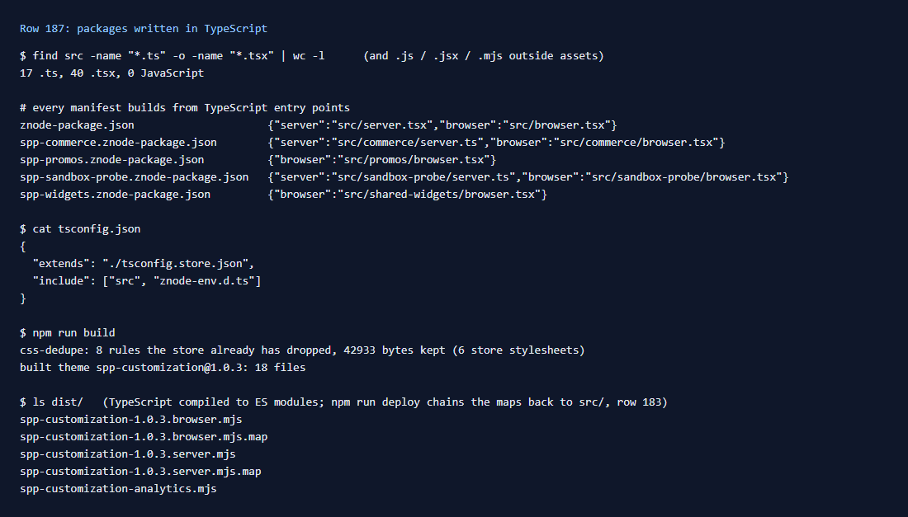

# 187: Can I write packages in TypeScript?

**Listed:** Yes. **Result here:** Yes. All five packages in this repository are written in TypeScript: 17 `.ts` and
40 `.tsx` files, and no JavaScript under `src/` except one script asset copied as it is
(`src/assets/spp-customization-analytics.mjs`, row 053). Every manifest's `build` entry points are `.ts` / `.tsx`, and
`npm run build` turns them into ES modules for the store.

## What was checked

[output.txt](output.txt): the file counts, the `build` entries of the five manifests, `tsconfig.json`, and a build.

How the SDK does it (`znode-plugin/lib/znode-package.mjs`):

1. With a `tsconfig.json` next to the manifest, `tsc --noEmit` checks the package against the store's real types
   (`tsconfig.store.json`, written by `npm run link-store`, maps every `@znode/*` alias to the store's source). An
   error in the package's own files stops the build (row 188).
2. Each `.ts` / `.tsx` file is transpiled on its own (`ts.transpileModule`, ES2022, JSX as Next.js does it:
   `react/jsx-runtime`).
3. Rollup bundles each entry point into one module: `<name>-<version>.server.mjs` and `.browser.mjs`, with source maps.
   `npm run deploy` chains those maps back to `src/` (row 183).

Types come from two places. `znode-plugin/types/extension-api.d.ts` is the public extension API (`IRuntimePlugin`,
`IBrowserPlugin`, `IBrowserHost`, slot and hook contexts). The linked store supplies its own types for what a package
imports from it (`@znode/*`, `next-intl`).

## How it renders

**In the webstore (base):** the store loads only the built `.mjs` files: server bundles by `import()` in
`registry.server.ts`, browser bundles from `/api/extensions/files/<file>`. It never sees TypeScript
([§1](../../RENDER-FLOW.md#1-from-this-repository-to-the-store-install-registry),
[§3 B.1](../../RENDER-FLOW.md#3-the-page-shell-root-layout-head-styles-labels-server-layout)).

**How this customization joins it:** the TypeScript is compiled in this repository by `npm run build` / `deploy`,
before install ([§1 step 1](../../RENDER-FLOW.md#1-from-this-repository-to-the-store-install-registry)).

End-to-end flow, with file and line references in the webstore: [docs/RENDER-FLOW.md](../../RENDER-FLOW.md).

## Where

- `src/**/*.ts`, `src/**/*.tsx`; `tsconfig.json`; the five `*znode-package.json` manifests (`build`)
- `docs/scenarios/187-typescript/` (README, output.txt, evidence.png)

## How a client does this

Start from `znode create <kind> <name>` (row 022), which writes a TypeScript package with a `tsconfig.json`, and run
`npm run link-store -- <store repo>` once so the store's types resolve.
