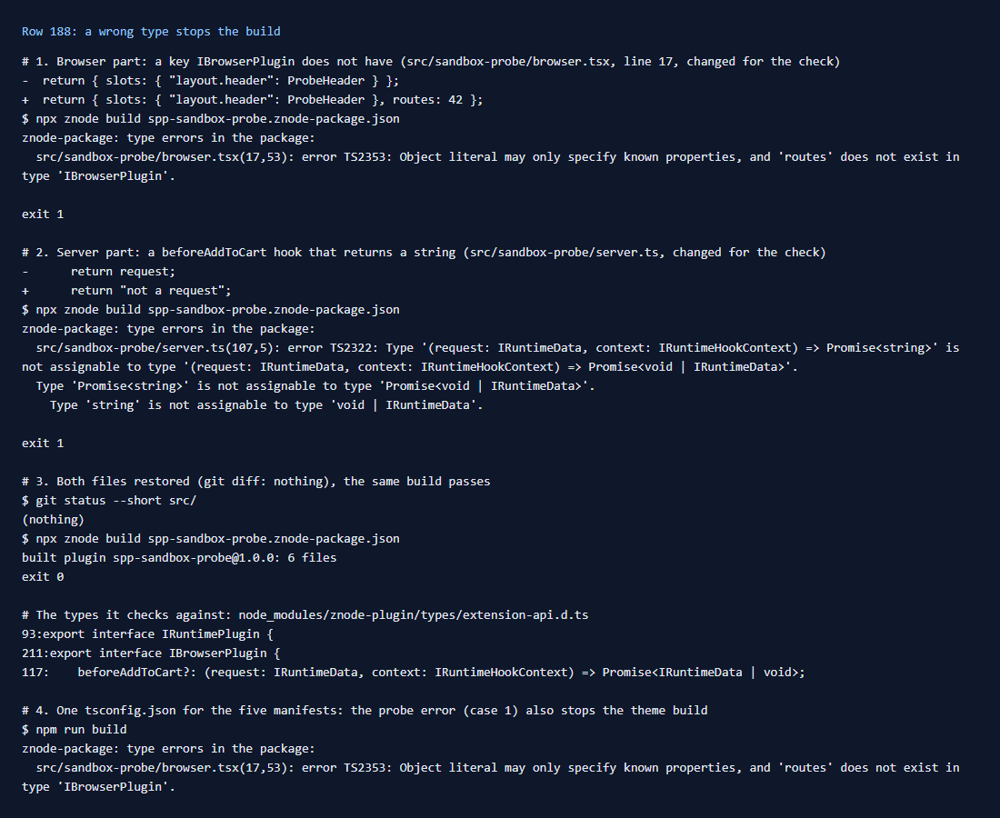

# 188: Are packages type-checked against the public API when built?

**Listed:** Yes. **Result here:** Yes. `znode build` runs `tsc --noEmit` before it compiles anything, and a type error
in the package stops the build (exit 1) with the file, line and message. Two wrong types were tried on the test
package, one in each part, and both stopped it:

| Change | Error |
|---|---|
| browser part returns `{ slots, routes: 42 }` | `TS2353: 'routes' does not exist in type 'IBrowserPlugin'` |
| `beforeAddToCart` returns a string | `TS2322: Type 'Promise<string>' is not assignable to type 'Promise<void \| IRuntimeData>'` |

With the files restored, the same build passes. All five manifests in this repository share one `tsconfig.json`
(`include: ["src"]`), so an error in any package also stops the build of the others: the probe's error stopped
`npm run build` of the theme too.

## What was checked

[output.txt](output.txt): each change, `npx znode build spp-sandbox-probe.znode-package.json` and its output, the
restore, and the theme build with the probe's error in place.

The SDK's `typeCheck` (`znode-plugin/lib/znode-package.mjs:146-166`) sorts `tsc`'s errors in two:

- in the package's folder: listed as errors, and the build stops;
- in store files the package imports (`@znode/*`, through `tsconfig.store.json`): listed as warnings, since they are
  the store's to fix, and the build goes on.

The public API is `znode-plugin/types/extension-api.d.ts`: `IRuntimePlugin` (server part: hooks, routes, server slots
and pages), `IBrowserPlugin` (browser part: slots, widgets) and the contexts each receives. A package checks against
it through `import type … from "znode-plugin/types/extension-api"`.

## How it renders

**In the webstore (base):** the store does not check types. It imports whatever `.mjs` is installed, and only checks
a server bundle's `name` and `apiVersion` (`registry.server.ts:89`)
([§1](../../RENDER-FLOW.md#1-from-this-repository-to-the-store-install-registry)).

**How this customization joins it:** the check happens in this repository, in step 1 of `npm run build` / `deploy`.
A package that fails it never reaches the plugin folder
([§1 step 1](../../RENDER-FLOW.md#1-from-this-repository-to-the-store-install-registry)).

End-to-end flow, with file and line references in the webstore: [docs/RENDER-FLOW.md](../../RENDER-FLOW.md).

## Where

- Nothing in the packages changed: both errors were made for the check and undone (`git status`: clean)
- `docs/scenarios/188-type-checked-build/` (README, output.txt, evidence.png)

## How a client does this

Type the parts with the public API (`IRuntimePlugin`, `IBrowserPlugin`, `IServerSlotContext`, …) instead of `any`.
That is what makes the check useful. With several packages in one repository, keep in mind that one broken package
blocks every deploy until it is fixed. Give each package its own `tsconfig.json` if that is not wanted.
