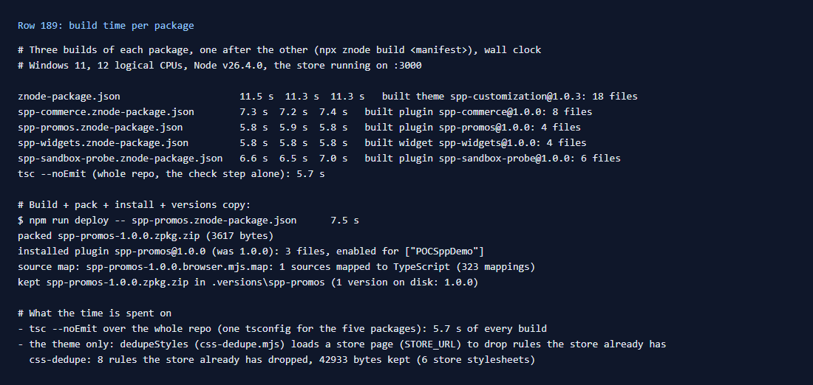

# 189: Does a package build quickly (seconds)?

**Listed:** Yes. **Result here:** Yes. Seconds, not minutes: each of the five packages built in **6 to 11.5 seconds**,
the same on three runs in a row. A full deploy (build, pack, install, keep a copy in `.versions/`) of spp-promos took
7.5 s.

| Package | Build (three runs) |
|---|---|
| spp-customization (theme) | 11.5 s, 11.3 s, 11.3 s |
| spp-commerce | 7.3 s, 7.2 s, 7.4 s |
| spp-sandbox-probe | 6.6 s, 6.5 s, 7.0 s |
| spp-promos | 5.8 s, 5.9 s, 5.8 s |
| spp-widgets | 5.8 s, 5.8 s, 5.8 s |

Most of each build is the type check: `tsc --noEmit` alone takes 5.7 s. It always covers the whole repository,
because the five manifests share one `tsconfig.json` (row 188). The theme also runs `dedupeStyles`, which loads a
page of the running store and drops the CSS rules the store already has. That part was not timed on its own.

## What was checked

[output.txt](output.txt): `npx znode build <manifest>` three times for each manifest, timed by a small Node script
(`performance.now()` around each run). Then `tsc --noEmit` alone, and one `npm run deploy`. Machine: Windows 11,
12 logical CPUs, Node 26, with the store running on `:3000`.

The edit loop is quicker still: `npm run dev` deploys on save (row 186), and the store picks up the new files without
a build or restart of its own (rows 008, 202).

## How it renders

**In the webstore (base):** no build of the store is involved. It reads `plugins.json` by its modification time and
imports the new bundle under a new `?v=` URL
([§1 step 3](../../RENDER-FLOW.md#1-from-this-repository-to-the-store-install-registry)).

**How this customization joins it:** `znode build` in this repository: type check, transpile, rollup, styles, assets
([§1 step 1](../../RENDER-FLOW.md#1-from-this-repository-to-the-store-install-registry)).

End-to-end flow, with file and line references in the webstore: [docs/RENDER-FLOW.md](../../RENDER-FLOW.md).

## Where

- No code change; `docs/scenarios/189-build-time/` (README, output.txt, evidence.png)

## How a client does this

Expect a few seconds per package, most of it in the type check. In a repository with many packages, a
`tsconfig.json` per package keeps each check to that package's files.
