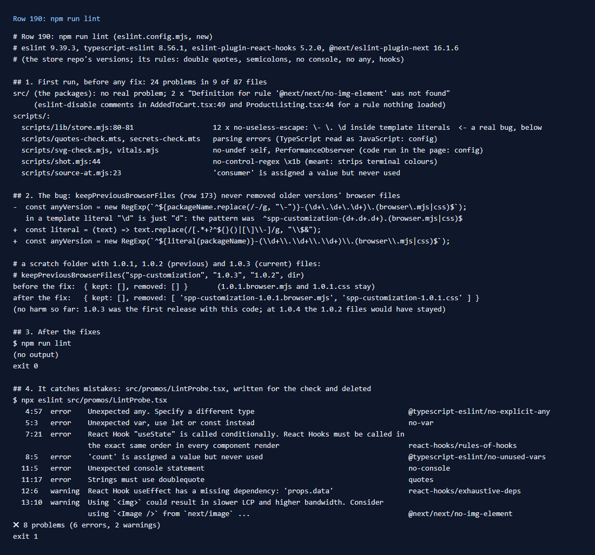

# 190: Can I lint a package?

**Listed:** No. **Result here:** Yes, in this repository. The SDK has no lint step, so `npm run lint` was added: ESLint
with the store repo's own versions and rules (double quotes, semicolons, no `console`, no `any`, the React hooks rules),
plus Next.js's rules, because the packages render inside the store's Next.js app. `scripts/` gets the plain
JavaScript rules.

Its first run found **a real bug**. `keepPreviousBrowserFiles` (row 173, zero-downtime release) builds two regular
expressions from template literals, where `\d` is just `d` and `\.` just `.`. So the pattern for "any older version"
was `^spp-customization-(d+.d+.d+)…`: it never matched a real file, and the older versions' browser files were never
removed. Nothing was harmed yet, because 1.0.3 is the first release with that code, but at 1.0.4 the 1.0.2 files
would have stayed for good. The fix escapes the parts properly. On a scratch folder, the old code removed nothing and
the fixed one removes the 1.0.1 files and keeps 1.0.2 and 1.0.3.

The package code in `src/` itself was clean: the only findings there were two `eslint-disable` comments for a Next.js
rule that nothing loaded until now.

## What was checked

[output.txt](output.txt):

1. The first run: 24 problems in 9 of 87 files, listed by file.
2. The bug in `scripts/lib/store.mjs`, before and after the fix, on a scratch folder.
3. After the fixes, `npm run lint` exits 0.
4. A file with eight mistakes, written for the check and deleted (`src/promos/LintProbe.tsx`): `any`, `var`, a
   hook called conditionally, an unused variable, `console`, single quotes, a missing effect dependency and ``.
   Six errors and two warnings, exit 1.

Other fixes from the first run:

- `scripts/source-at.mjs`: an unused `SourceMapConsumer` removed. `sourceAt` from `scripts/lib/source-maps.mjs` does
  the work, and `npm run source-at -- --sources …` still answers.
- `scripts/shot.mjs`: the terminal-colour regex keeps its `\x1b`, with a comment saying why.
- The config parses the two `.mts` checks as TypeScript, and knows the globals of code the scripts run in a page
  (`self`, `PerformanceObserver`).

## How it renders

**In the webstore (base):** lint changes nothing at run time. The store lints its own code with the same rules
(`eslint.config.mjs` in the store repo)
([§1](../../RENDER-FLOW.md#1-from-this-repository-to-the-store-install-registry)).

**How this customization joins it:** `npm run lint` runs before `npm run deploy`, on the same TypeScript that the
build turns into the bundles ([§1 step 1](../../RENDER-FLOW.md#1-from-this-repository-to-the-store-install-registry)).

End-to-end flow, with file and line references in the webstore: [docs/RENDER-FLOW.md](../../RENDER-FLOW.md).

## Where

- `eslint.config.mjs` (new); `package.json` (`npm run lint`, ESLint dev dependencies); `README.md` (commands table)
- `scripts/lib/store.mjs`: `keepPreviousBrowserFiles` patterns fixed
- `scripts/source-at.mjs`, `scripts/shot.mjs`: findings of the first run
- `docs/scenarios/190-lint/` (README, output.txt, evidence.png)

## How a client does this

Copy `eslint.config.mjs` and the five dev dependencies, then run `npm run lint` before each deploy. For a pattern
built from a template literal, double the backslashes or use `String.raw`, and give it a test (row 191).
