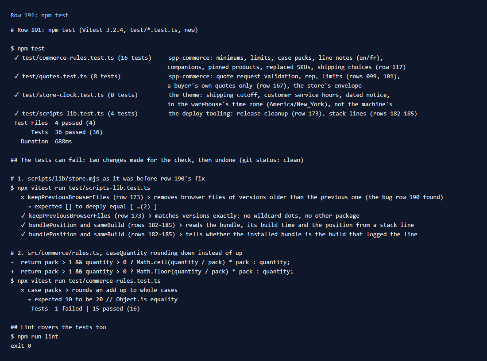

# 191: Can I unit test a package?

**Listed:** No. **Result here:** Yes, in this repository. The SDK has no test step, so `npm test` was added: Vitest,
with 36 tests in `test/` that run in under a second, without a store. They cover the logic the packages keep apart
from the store's hooks and slots:

| File | What it covers |
|---|---|
| `test/commerce-rules.test.ts` | spp-commerce's cart rules: minimums, per-order limits, case packs, line notes in English and French, companions, pinned products, replaced SKUs, the rush-shipping filter (row 117) |
| `test/quotes.test.ts` | quote requests: required fields, the shopper's rep, the comment limit (row 101), a buyer's own quotes only (row 167) |
| `test/store-clock.test.ts` | the theme's shipping cutoff, customer service hours and dated notice, in the warehouse's time zone |
| `test/scripts-lib.test.ts` | this repository's deploy tooling: the release cleanup (row 173, with row 190's bug as a regression test) and stack-line parsing (rows 182-185) |

They do fail when the code is wrong. Run against `scripts/lib/store.mjs` from before row 190's fix, the cleanup test
fails ("expected [] to deeply equal [ …(2) ]"). With `caseQuantity` rounding down instead of up, the case-pack test
fails ("expected 10 to be 20").

## What was checked

[output.txt](output.txt): `npm test` (4 files, 36 tests, 0.7 s); the two changes made for the check and their failing
tests, both undone; `npm run lint`, which now covers `test/`.

Why Vitest rather than Node's own test runner: `src/` imports its siblings as `./notice.js` (TypeScript's ESM style),
and Node alone does not map that to `notice.ts`. Vitest does, and reads TypeScript and JSX without a build. The store
repo uses Jest for its own code. Either fits, since the packages' logic needs nothing from the store.

What a unit test cannot cover here is the store around the logic: hooks, slots, the browser host. That is row 192
(end-to-end) and the scenario checks in `docs/scenarios/`.

## How it renders

**In the webstore (base):** nothing. The tests import the packages' TypeScript directly, with no store, plugin folder
or page ([§1](../../RENDER-FLOW.md#1-from-this-repository-to-the-store-install-registry)).

**How this customization joins it:** the functions under test are what spp-commerce's hooks
(`beforeAddToCart`, `onCartChanged`, `mapCartItems`) and the theme's `store-status` route call
([§6 B](../../RENDER-FLOW.md#6-add-to-cart), [§7 B](../../RENDER-FLOW.md#7-cart-checkout-place-order)).

End-to-end flow, with file and line references in the webstore: [docs/RENDER-FLOW.md](../../RENDER-FLOW.md).

## Where

- `test/*.test.ts` (new); `package.json` (`npm test`, Vitest); `eslint.config.mjs` (lint `test/`); `README.md`
- `docs/scenarios/191-unit-tests/` (README, output.txt, evidence.png)

## How a client does this

Keep a package's rules in plain functions that take settings and data and return results, as `src/commerce/rules.ts`
does, and call them from the hooks and slots. Then `npm test` covers them in seconds. `npm run quotes-check` and
`npm run secrets-check` (rows 159, 167) remain as the single-purpose checks they were.
