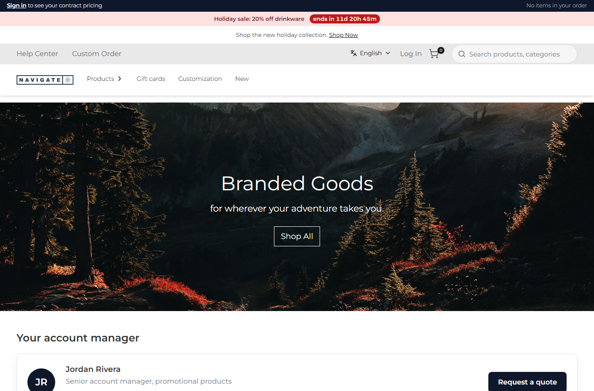
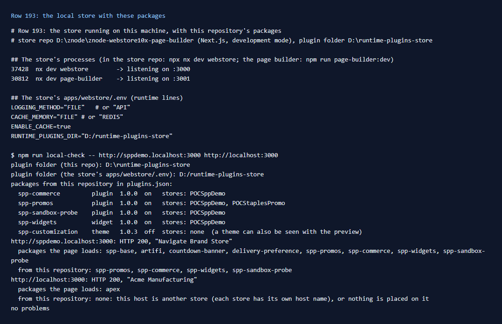

# 193: Can I run the store locally with packages?

**Listed:** Yes. **Result here:** Yes. Every scenario in this repository ran against the webstore on this machine: the
store repo in Next.js development mode on `:3000` (and the page builder on `:3001`), reading packages from a local
plugin folder. POCSppDemo at `http://sppdemo.localhost:3000` loads four of this repository's packages, and the theme
is shown through the preview.

The setup takes three things (1-3), and a fourth fact took a while to find:

1. **The store reads the plugin folder from `RUNTIME_PLUGINS_DIR`** in `apps/webstore/.env`
   (`D:/runtime-plugins-store`). Without it the store runs no packages at all.
2. **This repository deploys to the same folder**: `znode.local.json` (`{ "pluginsDir": … }`, git-ignored) or
   `RUNTIME_PLUGINS_DIR`.
3. **A package is placed on a store** in `plugins.json` (`"enabled": true`, `"stores": ["POCSppDemo"]`).
4. **Each store answers on its own host name.** Znode maps a domain to a store, so `localhost:3000` is one store and
   `sppdemo.localhost:3000` another. Today `localhost:3000` served MaxwellsHardware ("Acme Manufacturing", Apex theme)
   and loaded none of these packages. A page without your packages usually means the wrong host, not a broken install.

`npm run local-check` (new) checks all four in one go.

## What was checked

[output.txt](output.txt): the store's two dev processes and ports, the runtime lines of its `.env`, and
`npm run local-check -- http://sppdemo.localhost:3000 http://localhost:3000`:

- the plugin folder of this repository and of the store's `.env`: the same;
- this repository's five packages in `plugins.json`: version, on or off, stores;
- for each URL, the package bundles the page loads (`/api/extensions/files/<name>-<version>.browser.mjs` in its HTML).
  `sppdemo.localhost:3000` loads spp-promos, spp-commerce, spp-widgets and spp-sandbox-probe, and `localhost:3000`
  loads only `apex`.

`*.localhost` names reach this machine in a browser and in curl, but not in Node's resolver. The check connects to
127.0.0.1 with the store's `Host` header instead.

## How it renders

**In the webstore (base):** every request finds its store from the host name (domain → store code → portal), then
the packages placed on that store in `plugins.json`
([§2 A, B.2](../../RENDER-FLOW.md#2-which-store-which-packages-every-request)). `RUNTIME_PLUGINS_DIR` unset means no
packages ([§1](../../RENDER-FLOW.md#1-from-this-repository-to-the-store-install-registry)).

**How this customization joins it:** `npm run deploy` installs into the same folder, and `plugins.json` places each
package on POCSppDemo ([§1](../../RENDER-FLOW.md#1-from-this-repository-to-the-store-install-registry)).

End-to-end flow, with file and line references in the webstore: [docs/RENDER-FLOW.md](../../RENDER-FLOW.md).

## Where

- `scripts/local-check.mjs` (new), `package.json` (`npm run local-check`), `README.md` (commands table)
- `docs/scenarios/193-local-store/` (README, output.txt, evidence.png, store.png)

## How a client does this

In the store repo, set `RUNTIME_PLUGINS_DIR` in `apps/webstore/.env` and run `npx nx dev webstore`. In the package
repo, write `znode.local.json` with the same folder, run `npm run link-store -- <store repo>`, then `npm run deploy`.
Place the package on your store in `plugins.json`. Open the store by its own host name
(`<store>.localhost:3000`) and run `npm run local-check -- <that URL>` when something is missing.
