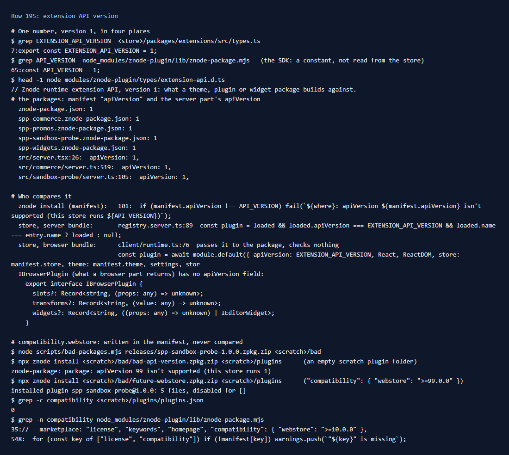

# 195: Is the extension API versioned?

**Listed:** Yes. **Result here:** Yes, with one number (version 1), and it is checked only for the server part. The
store, the SDK and the public types all say version 1, and every package here declares it. `znode install` refuses a
manifest with another number, and the store skips a server bundle with another one (row 017). What it does not cover:

- **Browser parts.** The store hands its version to a browser part (`setup(host)`, `host.apiVersion`), but nothing
  compares it. `IBrowserPlugin`, what a browser part returns, has no version. A browser-only package (spp-promos,
  spp-widgets) is checked only at install.
- **The SDK's number is its own.** `znode install` compares with `API_VERSION = 1` written in the SDK, not with the
  store it installs into, although the message says "this store runs 1".
- **`compatibility.webstore` is never compared.** A package asking for `"webstore": ">=99.0.0"` installed without a
  word, and the value is not kept in `plugins.json`. `znode check` only warns when the field is missing.
- **No ranges.** A package cannot say "1 or later". When the store moves to 2, every package must change its number
  even if it uses nothing that changed.

## What was checked

[output.txt](output.txt): the number in the store (`EXTENSION_API_VERSION`), the SDK (`API_VERSION`), the types header
and the packages; the three places that could compare it; and two installs into an empty scratch plugin folder:

| Case (`scripts/bad-packages.mjs`) | `znode install` |
|---|---|
| `bad-api-version`: `"apiVersion": 99` | refused: `apiVersion 99 isn't supported (this store runs 1)` |
| `future-webstore` (new): `"compatibility": { "webstore": ">=99.0.0" }` | installed |

## How it renders

**In the webstore (base):** `registry.server.ts:89` loads a server bundle only if its `apiVersion` and `name` match
the entry. `client/runtime.ts:76` calls each browser bundle's `setup` with `apiVersion: EXTENSION_API_VERSION` and
uses what it returns
([§1](../../RENDER-FLOW.md#1-from-this-repository-to-the-store-install-registry),
[§3 B.2](../../RENDER-FLOW.md#3-the-page-shell-root-layout-head-styles-labels-server-layout)).

**How this customization joins it:** each manifest declares `"apiVersion": 1`, and each server part
(`src/server.tsx`, `src/commerce/server.ts`, `src/sandbox-probe/server.ts`) sets `apiVersion: 1`
([§1](../../RENDER-FLOW.md#1-from-this-repository-to-the-store-install-registry)).

End-to-end flow, with file and line references in the webstore: [docs/RENDER-FLOW.md](../../RENDER-FLOW.md).

## Where

- `scripts/bad-packages.mjs`: the `future-webstore` case
- `docs/scenarios/195-api-versioned/` (README, output.txt, evidence.png)

## How a client does this

Declare `"apiVersion": 1` in the manifest and in the server part. In a browser part that depends on newer host
features, check `host.apiVersion` yourself and return no slots when it is not what you built for. For the platform:
compare `compatibility.webstore` at install, keep it in the registry, and let a package give a range of API versions.
