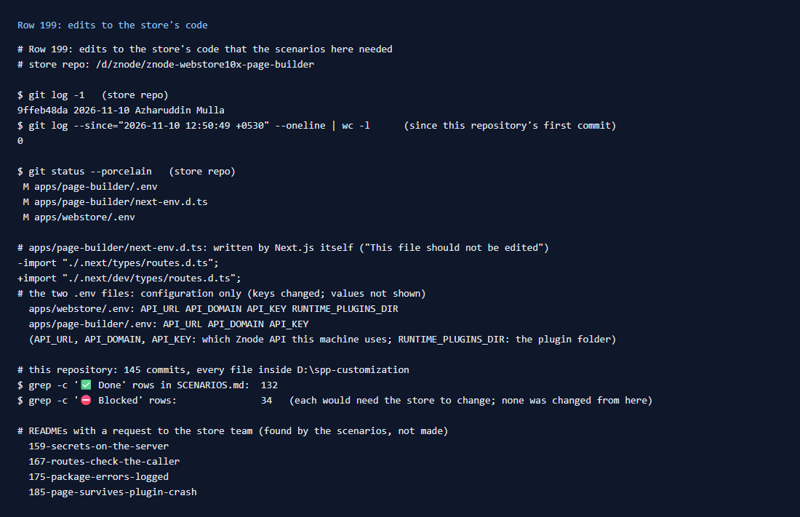

# 199: How many base code edits does all this need?

**Listed:** 0. **Result here:** 0. Every scenario done in this repository (132 rows before this one) was built with
packages alone. The store repo has **no commit** since this repository's first one. Its only uncommitted changes are
configuration on this machine, not code:

| Store file | Change | What it is |
|---|---|---|
| `apps/webstore/.env` | `API_URL`, `API_DOMAIN`, `API_KEY`, `RUNTIME_PLUGINS_DIR` | which Znode API this machine uses, and the plugin folder (row 193) |
| `apps/page-builder/.env` | `API_URL`, `API_DOMAIN`, `API_KEY` | the same for the page builder |
| `apps/page-builder/next-env.d.ts` | one import path | written by Next.js itself ("This file should not be edited") |

What "0" leaves out: 34 rows are ⛔ Blocked because they **would** need the store to change (a plugin database, the
payment step, account pages, SSO, an admin screen, …). None of them was worked around by editing the store. Four
scenario READMEs end with a request to the store team, for something the scenarios found rather than changed:
159 (secrets), 167 (routes trusting the caller), 175 (log written ten entries at a time) and 185 (a throwing browser
slot fails the server render).

## What was checked

[output.txt](output.txt), in the store repo: the latest commit, the number of commits since this repository's first
commit (0), `git status`, and what the changed files hold (key names only for the `.env` files, no values). In this
repository: the counts of Done and Blocked rows, and the READMEs that ask the store team for a change.

## How it renders

**In the webstore (base):** unchanged. The runtime package system (`packages/extensions/`: registry, slots, hooks,
routes, files route) is the store's own code, used as it is
([§1](../../RENDER-FLOW.md#1-from-this-repository-to-the-store-install-registry),
[§2](../../RENDER-FLOW.md#2-which-store-which-packages-every-request)).

**How this customization joins it:** only through that system: five packages built here, installed into the plugin
folder and placed in `plugins.json`. The scenario → commit list is
[§10](../../RENDER-FLOW.md#10-every-scenario-its-commits-and-where-it-acts).

End-to-end flow, with file and line references in the webstore: [docs/RENDER-FLOW.md](../../RENDER-FLOW.md).

## Where

- No code change; `docs/scenarios/199-no-base-edits/` (README, output.txt, evidence.png)

## How a client does this

Keep the store repo untouched, and every change in packages. Before a release, `git status` in the store repo should
list configuration only. When a row needs the store to change, mark it Blocked and ask for it, as the 34 rows do,
instead of patching the store locally.
