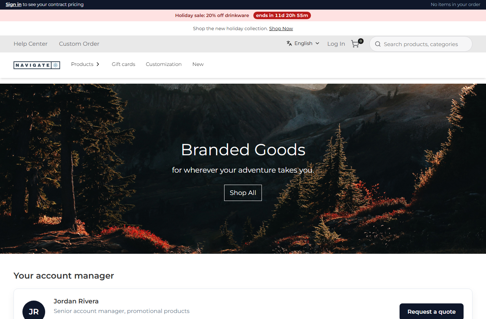

# 202: Does a runtime package change need a build or deploy?

**Listed:** No. **Result here:** No store build and no store deploy. Only the package is built and installed: one
command, `npm run deploy -- <manifest>`, which took 9.2 s here. The store picked it up on the next request, with the
same process still running, its `.next` folder untouched and none of its files changed.

| | Before | After |
|---|---|---|
| Store process (listening on :3000) | 27876, started 13:03:21 | 27876, started 13:03:21 |
| `apps/webstore/.next` last written | 2026-10-28 15:12 | 2026-10-28 15:12 |
| Store repo's changed files (content hash) | 3 of its own | the same 3, same hashes |
| Account bar | "to see your contract pricing" | "… (changed for row 202, no store build)" |

## What was checked

[output.txt](output.txt). One label of spp-commerce (`src/commerce/i18n/labels.json`, `toSeePricing`) was changed,
then `npm run deploy -- spp-commerce.znode-package.json` ran (13:34:08 to 13:34:17). The next `curl` of the home page
already had the new text. The store's process, build folder and files were compared before and after. Then the label
was restored and deployed again, so nothing in this commit changes the package.

Row 008 showed the same for the theme. This row repeats it for a plugin and also checks the store's side.

## How it renders

**In the webstore (base):** `readRegistry` re-reads `plugins.json` when its modification time changes, and the
package's bundles are imported again under a new `?v=<mtime>` URL, on the server and in the browser. Labels are merged
per request (`withRuntimeMessages`)
([§1 step 3](../../RENDER-FLOW.md#1-from-this-repository-to-the-store-install-registry),
[§3 B.7](../../RENDER-FLOW.md#3-the-page-shell-root-layout-head-styles-labels-server-layout)).

**How this customization joins it:** `npm run deploy` builds, packs and installs only the package into the plugin
folder (`RUNTIME_PLUGINS_DIR`), and the account bar reads the label through `useTranslations` (row 088)
([§8 B](../../RENDER-FLOW.md#8-header-footer-search)).

End-to-end flow, with file and line references in the webstore: [docs/RENDER-FLOW.md](../../RENDER-FLOW.md).

## Where

- No package change (the label was changed for the check, deployed, then restored and deployed again)
- `docs/scenarios/202-no-store-build/` (README, output.txt, before.png, after.png)

## How a client does this

`npm run deploy -- <manifest>` (or `npm run dev`, which deploys on every save, row 186). Nothing to build or restart
on the store. In production the same holds for every store instance that reads the same plugin folder.
